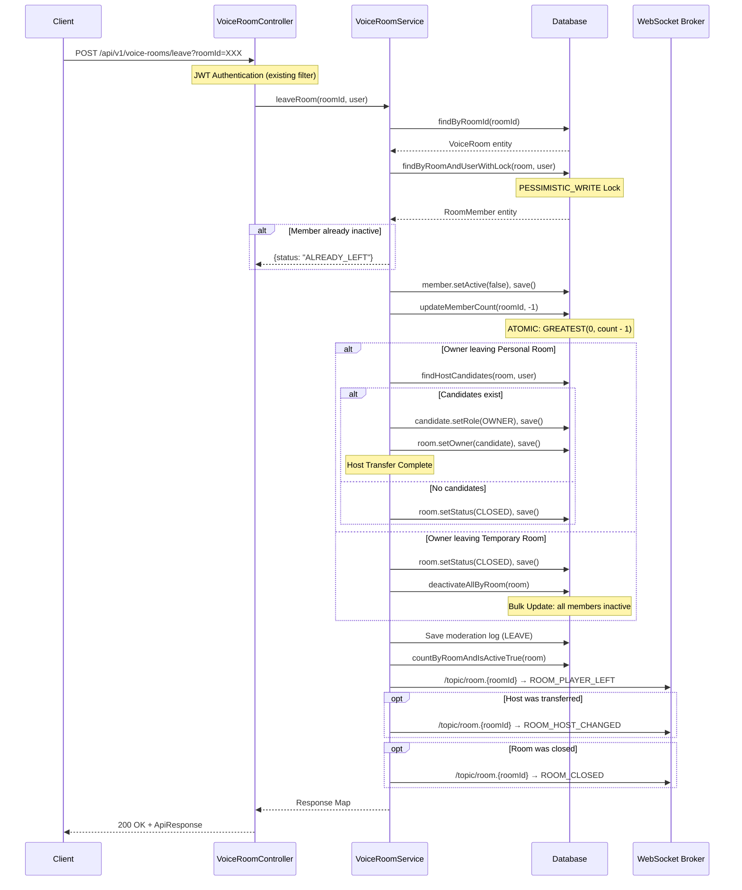
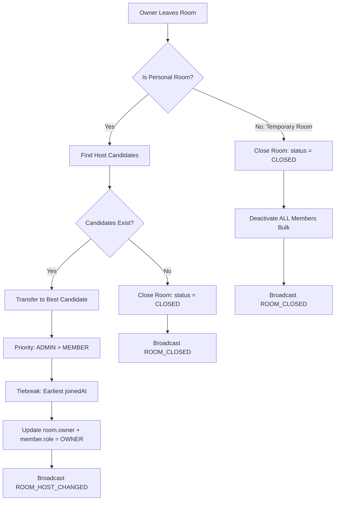
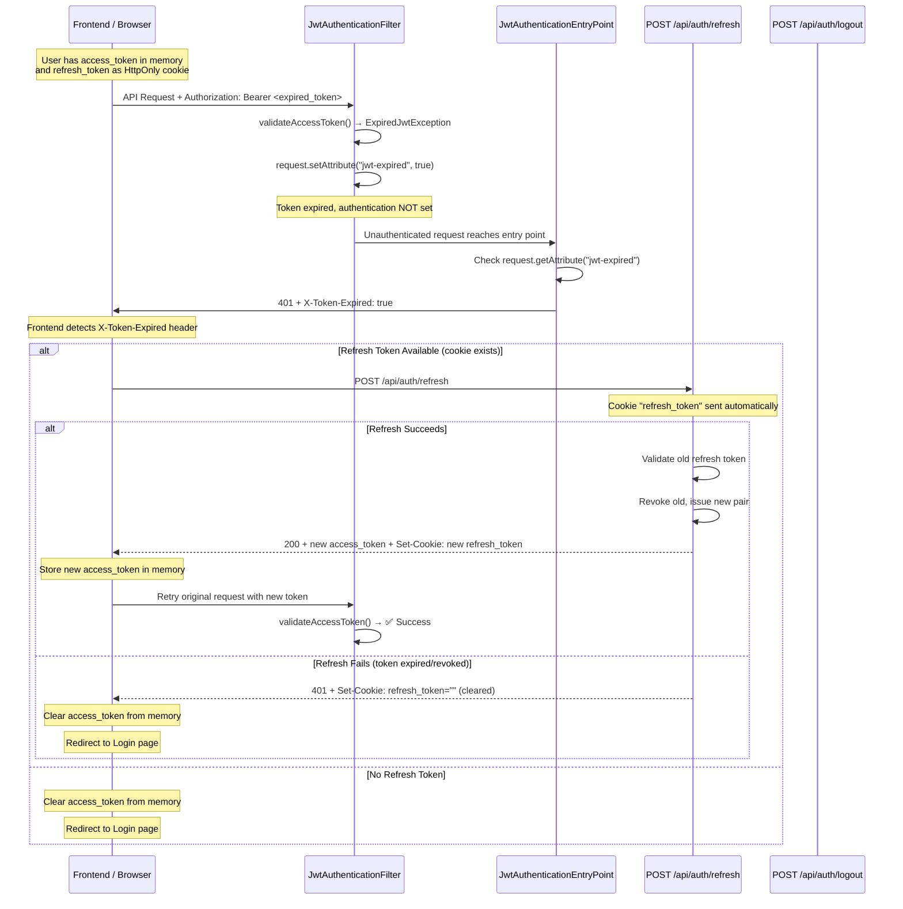

# FriendsTogether — Complete Flow Documentation

## Table of Contents
1. [Leave Room Feature](#1-leave-room-feature)
2. [Token Expiry & Refresh Flow](#2-token-expiry--refresh-flow)
3. [Files Modified](#3-files-modified)
4. [Backward Compatibility Checklist](#4-backward-compatibility-checklist)

---

## 1. Leave Room Feature

### 1.1 API Endpoint

```
POST /api/v1/voice-rooms/leave?roomId={roomId}
Authorization: Bearer <access_token>
```

**Response (200 OK):**
```json
{
  "success": true,
  "message": "Left successfully",
  "data": {
    "roomId": "12345678",
    "status": "LEFT_SUCCESSFULLY",
    "roomStatus": "ACTIVE",
    "userId": "987654321",
    "username": "shahvez",
    "remainingPlayers": 3,
    "newHostUserId": "111222333"  // Only present if host was transferred
  },
  "timestamp": 1719952500000
}
```

### 1.2 Leave Room — Sequence Diagram



### 1.3 Host Transfer Logic

When the **owner** leaves a room, the system follows this decision tree:



### 1.4 WebSocket Events

All events are broadcast to: **`/topic/room.{roomId}`**

Clients should subscribe to this topic when joining a room.

#### Event 1: `ROOM_PLAYER_LEFT`
Sent when any user leaves the room.

```json
{
  "event": "ROOM_PLAYER_LEFT",
  "roomId": "12345678",
  "userId": "987654321",
  "username": "shahvez",
  "remainingPlayers": 3
}
```

#### Event 2: `ROOM_HOST_CHANGED`
Sent only when the owner leaves a personal room and host is transferred.

```json
{
  "event": "ROOM_HOST_CHANGED",
  "roomId": "12345678",
  "newHostUserId": "111222333",
  "newHostUsername": "newowner"
}
```

#### Event 3: `ROOM_CLOSED`
Sent when a room is closed (owner left temp room, or last member left personal room).

```json
{
  "event": "ROOM_CLOSED",
  "roomId": "12345678",
  "reason": "Owner left the room"
}
```

### 1.5 Error Responses

| Scenario | HTTP Status | Message |
|----------|------------|---------|
| Room not found | 404 | "Room not found!" |
| User never a member | 400 | "You were never a member of this room!" |
| User not authenticated | 401 | "Authentication required. Please log in." |
| Token expired | 401 | "Access token expired. Please refresh your token." |
| Database error | 500 | "Server Error: An unexpected error occurred." |

> [!NOTE]
> WebSocket broadcast failures are **non-fatal** — the API still returns success. Broadcasts are best-effort wrapped in try-catch.

### 1.6 Concurrency Safety

- **Pessimistic Write Lock** on `RoomMember` during leave (prevents race conditions)
- **GREATEST(0, count - 1)** atomic SQL update prevents negative member counts
- **Idempotent**: calling leave twice returns `ALREADY_LEFT` without side effects

---

## 2. Token Expiry & Refresh Flow

### 2.1 Token Architecture

| Token | Lifetime | Storage | Purpose |
|-------|----------|---------|---------|
| Access Token | 15 min | Frontend memory (JS variable) | API authorization (`Authorization: Bearer`) |
| Refresh Token | 7 days | HttpOnly cookie (`refresh_token`) | Silent access token renewal |

### 2.2 Token Expiry Detection

When the access token expires, the backend now provides a clear signal:

**Response Header:** `X-Token-Expired: true`

**Response Body:**
```json
{
  "status": 401,
  "error": "Unauthorized",
  "message": "Access token expired. Please refresh your token.",
  "path": "/api/v1/voice-rooms/leave",
  "timestamp": "2026-07-02T18:06:00Z"
}
```

### 2.3 Complete Token Lifecycle — Sequence Diagram



### 2.4 Frontend Token Handling Guide

Any frontend consuming this API should implement this flow:

```
On every API call:
│
├── Response 200-299 → Success, proceed normally
│
└── Response 401
    │
    ├── Header "X-Token-Expired: true" present?
    │   │
    │   ├── YES → Token expired, try to refresh:
    │   │         1. Call POST /api/auth/refresh
    │   │            (refresh_token cookie sent automatically)
    │   │         2. If refresh returns 200:
    │   │            → Store new accessToken in memory
    │   │            → Retry the original failed request
    │   │         3. If refresh returns 401:
    │   │            → Refresh token also invalid
    │   │            → Call POST /api/auth/logout (clears cookie)
    │   │            → Clear accessToken from memory
    │   │            → Redirect to login page
    │   │
    │   └── NO → Token is missing or malformed:
    │             → Call POST /api/auth/logout (clears cookie)
    │             → Clear accessToken from memory
    │             → Redirect to login page
```

> [!IMPORTANT]
> The refresh token is stored as an **HttpOnly cookie** — JavaScript cannot read or delete it directly. To clear it:
> 1. Call `POST /api/auth/logout` — the server sets `Set-Cookie: refresh_token=""; Max-Age=0`
> 2. The browser automatically removes the cookie
> 3. Then clear the in-memory access token from your JavaScript variable/state

### 2.5 What Gets Cleared from Browser Memory

| Item | Where Stored | How to Clear |
|------|-------------|-------------|
| Access Token | JS variable / state management | Set to `null` in your code |
| Refresh Token | HttpOnly cookie | Call `POST /api/auth/logout` (server clears it) |
| User info | JS variable / localStorage | Clear from your code |
| Room state | JS variable / state | Clear from your code on room leave |
| WebSocket connection | STOMP client | Call `stompClient.deactivate()` |

---

## 3. Files Modified

### 3.1 Summary Table

| # | File | Change | Lines Changed |
|---|------|--------|---------------|
| 1 | [ModerationAction.java](file:///f:/FriendsToGetherBackend/friendstogether/src/main/java/com/gaur/friendstogether/entity/ModerationAction.java) | Added `LEAVE`, `HOST_TRANSFER` enum values | +2 |
| 2 | [RoomMemberRepository.java](file:///f:/FriendsToGetherBackend/friendstogether/src/main/java/com/gaur/friendstogether/repository/RoomMemberRepository.java) | Added `findHostCandidates()` query | +17 |
| 3 | [VoiceRoomService.java](file:///f:/FriendsToGetherBackend/friendstogether/src/main/java/com/gaur/friendstogether/service/VoiceRoomService.java) | Enhanced `leaveRoom()` with WebSocket broadcast + host transfer | +84 |
| 4 | [JwtAuthenticationFilter.java](file:///f:/FriendsToGetherBackend/friendstogether/src/main/java/com/gaur/friendstogether/security/config/JwtAuthenticationFilter.java) | Added expired token flagging via request attribute | +6 |
| 5 | [JwtAuthenticationEntryPoint.java](file:///f:/FriendsToGetherBackend/friendstogether/src/main/java/com/gaur/friendstogether/security/config/JwtAuthenticationEntryPoint.java) | Added `X-Token-Expired` header + context-aware message | +10 |

### 3.2 What Was NOT Changed

- ❌ No new files created
- ❌ No controller changes
- ❌ No entity/model schema changes
- ❌ No DTO changes
- ❌ No authentication flow changes
- ❌ No existing API behavior changes
- ❌ No existing socket events changed
- ❌ No database migration needed
- ❌ No package structure changes
- ❌ No Redis/cache logic changes
- ❌ No file renames

---

## 4. Backward Compatibility Checklist

| Feature | Status | Details |
|---------|--------|---------|
| Room Creation (`POST /create`) | ✅ Unchanged | No modifications |
| Room Join (`POST /join`) | ✅ Unchanged | No modifications |
| Room Leave (`POST /leave`) | ✅ Enhanced | Same endpoint, enriched response + WebSocket events added |
| Kick Member (`POST /kick`) | ✅ Unchanged | No modifications |
| Ban/Unban (`POST /ban`, `/unban`) | ✅ Unchanged | No modifications |
| Promote/Demote (`POST /promote`, `/demote`) | ✅ Unchanged | No modifications |
| Discovery API (`GET /api/v1/discovery`) | ✅ Unchanged | No modifications |
| Chat WebSocket (`/app/chat.sendMessage`) | ✅ Unchanged | No modifications |
| Presence System (Redis) | ✅ Unchanged | No modifications |
| JWT Authentication | ✅ Enhanced | Added `X-Token-Expired` header (additive, non-breaking) |
| OAuth2 Login | ✅ Unchanged | No modifications |
| Refresh Token Flow | ✅ Unchanged | Existing `/api/auth/refresh` works as before |
| Logout Flow | ✅ Unchanged | Existing `/api/auth/logout` works as before |
| Database Schema | ✅ Unchanged | No new columns/tables (enum values are application-level) |

> [!TIP]
> The `ModerationAction` enum values (`LEAVE`, `HOST_TRANSFER`) are stored as strings in the database via `@Enumerated(EnumType.STRING)`. Adding new enum values does **not** require a database migration — existing rows are unaffected.
