# 🔐 FriendsTogether — OAuth 2.0 Complete Implementation Guide

> **Project:** FriendsTogether Backend (Spring Boot 4 + Spring Security 7)  
> **Author:** Mohd Shahvez  
> **Date:** June 2026  
> **Status:** ✅ Production Ready

---

## 📑 Table of Contents

1. [What is OAuth 2.0?](#1-what-is-oauth-20)
2. [FriendsTogether Authentication Architecture](#2-friendstogether-authentication-architecture)
3. [Google OAuth2 — Complete Flow](#3-google-oauth2--complete-flow)
4. [File Architecture & Responsibilities](#4-file-architecture--responsibilities)
5. [Implementation — Step by Step](#5-implementation--step-by-step)
6. [Code Walkthrough — Every File Explained](#6-code-walkthrough--every-file-explained)
7. [How Each Component Calls The Next](#7-how-each-component-calls-the-next)
8. [Database Schema & Entity Design](#8-database-schema--entity-design)
9. [Redis TEMP_CODE Architecture](#9-redis-temp_code-architecture)
10. [Security Configuration Deep Dive](#10-security-configuration-deep-dive)
11. [Challenges Faced & Solutions](#11-challenges-faced--solutions)
12. [Testing Scenarios](#12-testing-scenarios)
13. [Production Checklist](#13-production-checklist)

---

## 1. What is OAuth 2.0?

OAuth 2.0 ek **authorization framework** hai jo third-party applications ko user ke data ka limited access deta hai — **bina user ka password share kiye**.

### Simple Analogy

```
Tum ek hotel mein gaye. Reception pe tumne ID dikhaya.
Reception ne tumhe ek key card diya (access token).
Ab tum key card se apna room khol sakte ho.
Tumne hotel ko apna ghar ki chaabi nahi di — sirf ID dikhayi.

OAuth 2.0 mein:
- Tum = User
- Hotel = FriendsTogether App
- Reception = Google
- ID = Google Account
- Key Card = Access Token
```

### OAuth 2.0 Roles

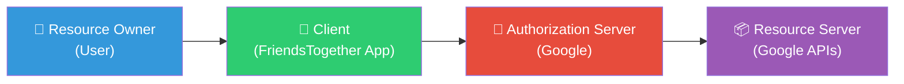

| Role | Kaun Hai | Kya Karta Hai |
|------|----------|---------------|
| **Resource Owner** | User (Mohd Shahvez) | Apna Google account allow karta hai |
| **Client** | FriendsTogether Backend | Google se user info maangta hai |
| **Authorization Server** | Google OAuth Server | User ko verify karta hai, token deta hai |
| **Resource Server** | Google APIs | User info (email, name) provide karta hai |

### OAuth 2.0 Grant Types

| Grant Type | Use Case | FriendsTogether mein? |
|------------|----------|----------------------|
| **Authorization Code** | Server-side apps (most secure) | ✅ **YES — This one!** |
| Client Credentials | Machine-to-machine | ❌ No |
| Implicit | Single-page apps (deprecated) | ❌ No |
| Resource Owner Password | Direct password (not recommended) | ❌ No |

---

## 2. FriendsTogether Authentication Architecture

FriendsTogether **hybrid authentication** support karta hai — dono LOCAL aur GOOGLE login:


### Key Difference

| Feature | LOCAL | GOOGLE |
|---------|-------|--------|
| Password | Stored (BCrypt hashed) | NULL (no password) |
| Email Verification | OTP required | Google verified |
| isEnabled | false → true (after OTP) | true (immediately) |
| authProvider | `LOCAL` | `GOOGLE` |
| userId (9-digit) | Generated after OTP verify | Generated at creation |
| UserProfile | Created at registration | Created at OAuth login |

---

## 3. Google OAuth2 — Complete Flow

### Phase 1: Authorization Request

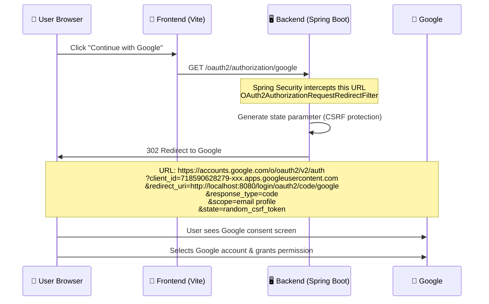

### Phase 2: Authorization Code Exchange

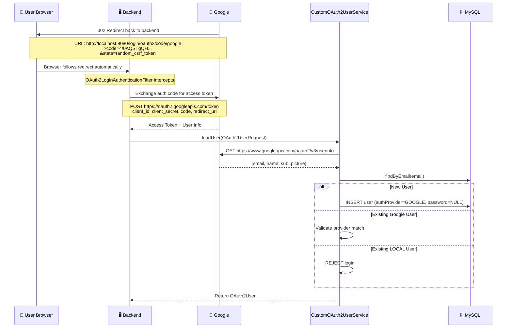

### Phase 3: TEMP_CODE + JWT Exchange

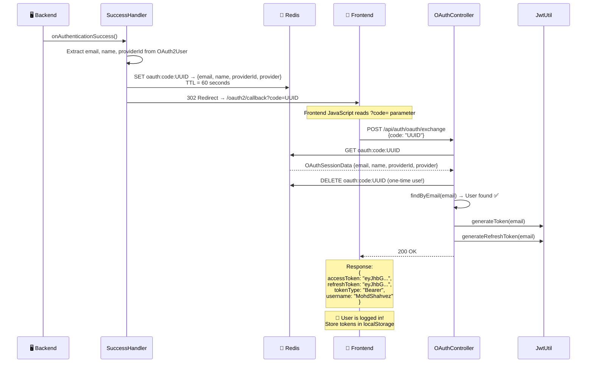

### Why TEMP_CODE? Why Not Direct JWT?

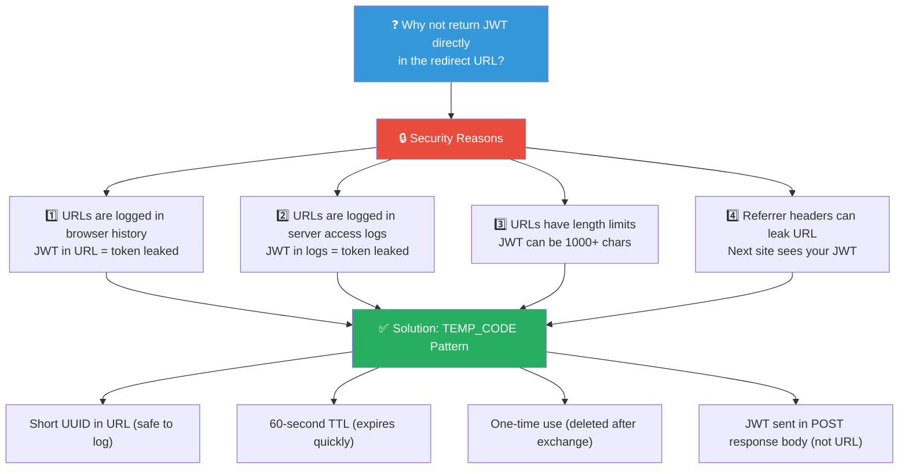

---

## 4. File Architecture & Responsibilities

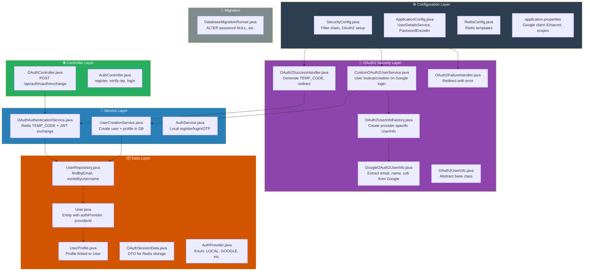

---

## 5. Implementation — Step by Step

### Step 1: Google Cloud Console Setup

```
1. Go to console.cloud.google.com
2. Create project → "FriendsTogether"
3. APIs & Services → Credentials
4. Create OAuth 2.0 Client ID:
   - Application type: Web application
   - Authorized redirect URIs: 
     http://localhost:8080/login/oauth2/code/google
5. Copy: Client ID + Client Secret
```

### Step 2: Maven Dependencies (pom.xml)

```xml
<!-- Spring Security OAuth2 Client -->
<dependency>
    <groupId>org.springframework.boot</groupId>
    <artifactId>spring-boot-starter-oauth2-client</artifactId>
</dependency>

<!-- Spring Security -->
<dependency>
    <groupId>org.springframework.boot</groupId>
    <artifactId>spring-boot-starter-security</artifactId>
</dependency>

<!-- Redis (for TEMP_CODE) -->
<dependency>
    <groupId>org.springframework.boot</groupId>
    <artifactId>spring-boot-starter-data-redis</artifactId>
</dependency>

<!-- JWT -->
<dependency>
    <groupId>io.jsonwebtoken</groupId>
    <artifactId>jjwt-api</artifactId>
</dependency>
```

### Step 3: Application Properties

```properties
# Google OAuth2 Configuration
spring.security.oauth2.client.registration.google.client-id=YOUR_CLIENT_ID
spring.security.oauth2.client.registration.google.client-secret=YOUR_CLIENT_SECRET
spring.security.oauth2.client.registration.google.scope=email,profile

# Frontend redirect URL (after OAuth success)
app.oauth.redirect-uri=http://localhost:5173/oauth2/callback

# IMPORTANT: Do NOT include 'openid' in scope!
# openid → Spring uses OidcUserService (ignores your CustomOAuth2UserService)
# email,profile → Spring uses DefaultOAuth2UserService (calls YOUR service)
```

### Step 4: Entity Design

```java
@Entity
@Table(name = "users")
public class User {
    @Id
    @GeneratedValue(strategy = GenerationType.IDENTITY)
    private Long id;
    
    @Column(unique = true, nullable = false)
    private String email;
    
    @Column(nullable = true)      // ← NULL for OAuth users!
    private String password;
    
    @Enumerated(EnumType.STRING)
    @Column(nullable = false)
    private AuthProvider authProvider;  // LOCAL, GOOGLE, APPLE...
    
    private String providerId;         // Google's "sub" ID
    
    @Column(unique = true, length = 9)
    private String userId;             // 9-digit unique ID
    
    private boolean isEnabled;         // true for OAuth, false until OTP for LOCAL
    
    @OneToOne(mappedBy = "user", cascade = CascadeType.ALL)
    private UserProfile profile;
}
```

### Step 5: Security Config

```java
@Bean
public SecurityFilterChain securityFilterChain(HttpSecurity http) throws Exception {
    http
        .cors(cors -> {})
        .csrf(AbstractHttpConfigurer::disable)
        .authorizeHttpRequests(auth -> auth
            .requestMatchers("/api/auth/**").permitAll()
            .requestMatchers("/ws/**").permitAll()
            .anyRequest().authenticated()
        )
        .oauth2Login(oauth2 -> oauth2
            .userInfoEndpoint(userInfo -> userInfo
                .userService(customOAuth2UserService)   // YOUR service
            )
            .successHandler(oAuth2AuthenticationSuccessHandler)
            .failureHandler(oAuth2AuthenticationFailureHandler)
        )
        .sessionManagement(session -> session
            .sessionCreationPolicy(SessionCreationPolicy.STATELESS)
        )
        .addFilterBefore(jwtAuthFilter, UsernamePasswordAuthenticationFilter.class);
    
    return http.build();
}
```

### Step 6: Custom OAuth2 User Service

```java
@Service
public class CustomOAuth2UserService extends DefaultOAuth2UserService {

    public OAuth2User loadUser(OAuth2UserRequest userRequest) {
        OAuth2User oAuth2User = super.loadUser(userRequest);  // Fetch from Google
        
        // Extract user info
        String email = oAuth2UserInfo.getEmail();
        
        // Check if user exists
        Optional<User> existing = userRepository.findByEmail(email);
        
        if (existing.isPresent()) {
            // Validate: same provider? same providerId?
        } else {
            // NEW USER → Create in database!
            userCreationService.createOAuthUser(userInfo, AuthProvider.GOOGLE);
        }
        
        return oAuth2User;
    }
}
```

### Step 7: User Creation Service

```java
@Transactional
public User createOAuthUser(OAuth2UserInfo userInfo, AuthProvider provider) {
    User user = User.builder()
        .email(userInfo.getEmail())
        .password(null)              // No password for OAuth!
        .isEnabled(true)             // Already verified by Google
        .authProvider(provider)      // GOOGLE
        .providerId(userInfo.getId()) // Google's "sub"
        .userId(generateUniqueId())  // 9-digit ID
        .build();
    
    UserProfile profile = UserProfile.builder()
        .nickname(userInfo.getName())
        .level(1)
        .user(user)
        .build();
    user.setProfile(profile);
    
    return userRepository.saveAndFlush(user);  // Immediate INSERT!
}
```

### Step 8: Success Handler + Redis

```java
public void onAuthenticationSuccess(request, response, authentication) {
    // Extract user info from OAuth2 token
    OAuth2User oAuth2User = oauthToken.getPrincipal();
    String email = userInfo.getEmail();
    
    // Generate one-time code and store in Redis (60 seconds TTL)
    String tempCode = UUID.randomUUID().toString();
    redis.set("oauth:code:" + tempCode, sessionData, 60, SECONDS);
    
    // Redirect frontend with the code
    redirect("http://localhost:5173/oauth2/callback?code=" + tempCode);
}
```

### Step 9: Token Exchange Endpoint

```java
@PostMapping("/api/auth/oauth/exchange")
public AuthResponse exchangeCode(String tempCode) {
    // Get session data from Redis
    OAuthSessionData session = redis.get("oauth:code:" + tempCode);
    redis.delete("oauth:code:" + tempCode);  // One-time use!
    
    // Find user in database
    User user = userRepository.findByEmail(session.getEmail());
    
    // Generate JWTs
    String accessToken = jwtUtil.generateToken(user.getEmail());
    String refreshToken = jwtUtil.generateRefreshToken(user.getEmail());
    
    return new AuthResponse(accessToken, refreshToken, "Bearer", user.getUsername());
}
```

---

## 6. Code Walkthrough — Every File Explained

### 📄 OAuth2UserInfo.java — Abstract Base

```java
// Ye abstract class har OAuth provider (Google, Apple, Facebook)
// ke liye common interface define karta hai
public abstract class OAuth2UserInfo {
    protected Map<String, Object> attributes;  // Raw data from provider
    
    public abstract String getId();     // Provider's unique ID
    public abstract String getName();   // User's display name
    public abstract String getEmail();  // User's email
}
```

### 📄 GoogleOAuth2UserInfo.java — Google-Specific

```java
// Google ke response mein specific keys hain:
// "sub" = unique ID, "name" = full name, "email" = email
public class GoogleOAuth2UserInfo extends OAuth2UserInfo {
    public String getId()    { return attributes.get("sub"); }
    public String getName()  { return attributes.get("name"); }
    public String getEmail() { return attributes.get("email"); }
}
```

### 📄 OAuth2UserInfoFactory.java — Factory Pattern

```java
// registrationId ke basis pe correct UserInfo class return karta hai
// Future mein Apple, Facebook add karna ho toh yahan add karo
public static OAuth2UserInfo getOAuth2UserInfo(String registrationId, Map attributes) {
    if (registrationId.equalsIgnoreCase("google")) {
        return new GoogleOAuth2UserInfo(attributes);
    }
    // Future: else if ("apple") → return new AppleOAuth2UserInfo(attributes);
    throw new IllegalArgumentException("Login with " + registrationId + " not supported");
}
```

### 📄 OAuthSessionData.java — Redis DTO

```java
// Redis mein store hone wala temporary data
// Ye Google se mila data temporarily hold karta hai
// Token exchange ke time use hota hai
public class OAuthSessionData implements Serializable {
    private String email;       // mohd.shahvez.dev@gmail.com
    private String username;    // Mohd Shahvez
    private String providerId;  // 116319787545504381370
    private String provider;    // google
}
```

### 📄 AuthProvider.java — Enum

```java
// Ye define karta hai ki user ne kaunsa method use kiya login ke liye
public enum AuthProvider {
    LOCAL,      // Email + Password
    GOOGLE,     // Google OAuth2
    APPLE,      // Future
    FACEBOOK,   // Future
    GITHUB      // Future
}
```

---

## 7. How Each Component Calls The Next

### Call Chain — New Google User (First Login)

```
1. Browser
   │
   ├──▶ GET /oauth2/authorization/google
   │    │
   │    └──▶ [Spring Security: OAuth2AuthorizationRequestRedirectFilter]
   │         │
   │         └──▶ 302 Redirect → Google consent screen
   │
   ├──▶ Google callback: /login/oauth2/code/google?code=xxx
   │    │
   │    └──▶ [Spring Security: OAuth2LoginAuthenticationFilter]
   │         │
   │         └──▶ [OAuth2LoginAuthenticationProvider]
   │              │
   │              ├──▶ Exchange auth code for access token (Google)
   │              │
   │              └──▶ CustomOAuth2UserService.loadUser()
   │                   │
   │                   ├──▶ super.loadUser() → Fetch userinfo from Google
   │                   │    Returns: OAuth2User {email, name, sub, picture}
   │                   │
   │                   └──▶ processOAuth2User()
   │                        │
   │                        ├──▶ OAuth2UserInfoFactory.getOAuth2UserInfo("google", attributes)
   │                        │    Returns: GoogleOAuth2UserInfo
   │                        │
   │                        ├──▶ userRepository.findByEmail("mohd.shahvez.dev@gmail.com")
   │                        │    Returns: Optional.empty() (new user!)
   │                        │
   │                        ├──▶ AuthProvider.valueOf("GOOGLE")
   │                        │
   │                        └──▶ userCreationService.createOAuthUser(userInfo, GOOGLE)
   │                             │ [@Transactional]
   │                             │
   │                             ├──▶ userRepository.existsByUsername("MohdShahvez")
   │                             │    Returns: false
   │                             │
   │                             ├──▶ idGenerator.generateUniqueUserId()
   │                             │    │
   │                             │    └──▶ userRepository.existsByUserId("417294960")
   │                             │         Returns: false (unique!)
   │                             │
   │                             ├──▶ User.builder()...build()
   │                             │    + UserProfile.builder()...build()
   │                             │
   │                             └──▶ userRepository.saveAndFlush(user)
   │                                  │
   │                                  └──▶ MySQL: INSERT INTO users (...)
   │                                       MySQL: INSERT INTO user_profiles (...)
   │                                       Returns: User {id=42}
   │
   ├──▶ [Authentication SUCCESS]
   │    │
   │    └──▶ OAuth2AuthenticationSuccessHandler.onAuthenticationSuccess()
   │         │
   │         ├──▶ Extract email from OAuth2User attributes
   │         │
   │         ├──▶ oAuthAuthenticationService.generateAndStoreTempCode()
   │         │    │
   │         │    ├──▶ UUID.randomUUID() → "2119de1f-7d50-42bc..."
   │         │    │
   │         │    └──▶ Redis: SET oauth:code:2119de1f... → {email, name, ...}
   │         │         TTL = 60 seconds
   │         │
   │         └──▶ 302 Redirect → http://localhost:5173/oauth2/callback?code=2119de1f...
   │
   ├──▶ Frontend receives ?code=2119de1f...
   │    │
   │    └──▶ POST /api/auth/oauth/exchange {code: "2119de1f..."}
   │         │
   │         └──▶ OAuthController.exchangeCode()
   │              │
   │              └──▶ oAuthAuthenticationService.exchangeCodeForTokens()
   │                   │
   │                   ├──▶ Redis: GET oauth:code:2119de1f...
   │                   │    Returns: OAuthSessionData {email: "mohd.shahvez.dev@gmail.com"}
   │                   │
   │                   ├──▶ Redis: DELETE oauth:code:2119de1f...
   │                   │
   │                   ├──▶ userRepository.findByEmail("mohd.shahvez.dev@gmail.com")
   │                   │    Returns: User {id=42, authProvider=GOOGLE}
   │                   │
   │                   ├──▶ jwtUtil.generateToken("mohd.shahvez.dev@gmail.com")
   │                   │    Returns: "eyJhbGciOiJIUzI1NiJ9..."
   │                   │
   │                   ├──▶ jwtUtil.generateRefreshToken("mohd.shahvez.dev@gmail.com")
   │                   │    Returns: "eyJhbGciOiJIUzI1NiJ9..."
   │                   │
   │                   └──▶ Return AuthResponse
   │                        {accessToken, refreshToken, "Bearer", "MohdShahvez"}
   │
   └──▶ 🎉 User logged in! Frontend stores tokens.
```

---

## 8. Database Schema & Entity Design

### Users Table

```sql
CREATE TABLE users (
    id            BIGINT AUTO_INCREMENT PRIMARY KEY,
    user_id       VARCHAR(9) UNIQUE,           -- 9-digit unique social ID
    username      VARCHAR(255) UNIQUE NOT NULL, -- Display name
    email         VARCHAR(255) UNIQUE NOT NULL, -- Login email
    password      VARCHAR(255) NULL,            -- NULL for OAuth users!
    otp           VARCHAR(255),                 -- OTP for local registration
    otp_expiry    DATETIME,                     -- OTP expiry time
    is_enabled    BOOLEAN DEFAULT FALSE,        -- Account active?
    auth_provider VARCHAR(20) NOT NULL,         -- LOCAL, GOOGLE, APPLE...
    provider_id   VARCHAR(255),                 -- Google's "sub" ID
    
    INDEX idx_username (username),
    INDEX idx_email (email),
    INDEX idx_user_id (user_id)
);
```

### User Profiles Table

```sql
CREATE TABLE user_profiles (
    id              BIGINT AUTO_INCREMENT PRIMARY KEY,
    nickname        VARCHAR(255),
    avatar_url      VARCHAR(255),
    gender          VARCHAR(50),
    dob             DATE,
    region          VARCHAR(100),
    signature       VARCHAR(500),
    title_badge     VARCHAR(100),
    coins_balance   BIGINT DEFAULT 0,
    charm_points    BIGINT DEFAULT 0,
    login_streak    INT DEFAULT 0,
    last_login_date DATE,
    tier            VARCHAR(20) DEFAULT 'SILVER',
    level           INT DEFAULT 1,
    user_id         BIGINT REFERENCES users(id)   -- FK to users table
);
```

### Entity Relationship

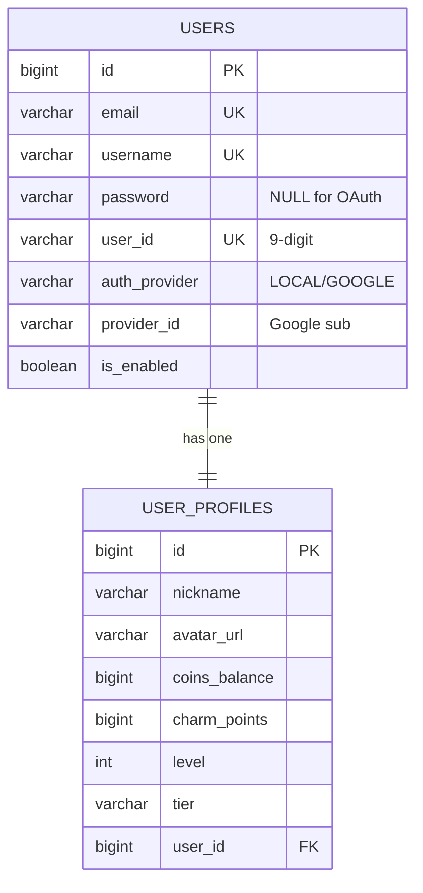

### What a LOCAL User Looks Like in DB

```
id=1, email=test@gmail.com, username=TestUser, 
password=$2a$10$xKz...hashed..., auth_provider=LOCAL,
provider_id=NULL, user_id=583291746, is_enabled=true
```

### What a GOOGLE User Looks Like in DB

```
id=42, email=mohd.shahvez.dev@gmail.com, username=MohdShahvez,
password=NULL, auth_provider=GOOGLE,
provider_id=116319787545504381370, user_id=417294960, is_enabled=true
```

---

## 9. Redis TEMP_CODE Architecture

### Why Redis?

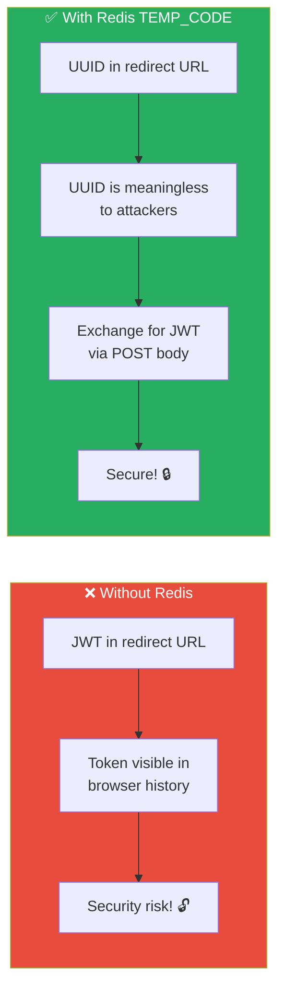

### Redis Data Flow

```
STEP 1: Success Handler stores data
┌─────────────────────────────────────────────────┐
│ Redis Key: "oauth:code:2119de1f-7d50-42bc-..."  │
│ Redis Value: {                                   │
│   "email": "mohd.shahvez.dev@gmail.com",         │
│   "username": "Mohd Shahvez",                    │
│   "providerId": "116319787545504381370",         │
│   "provider": "google"                           │
│ }                                                │
│ TTL: 60 seconds                                  │
└─────────────────────────────────────────────────┘

STEP 2: Exchange endpoint reads & deletes
┌─────────────────────────────────────────────────┐
│ GET oauth:code:2119de1f...  → OAuthSessionData  │
│ DELETE oauth:code:2119de1f... → one-time use!   │
└─────────────────────────────────────────────────┘

After 60 seconds OR after exchange:
┌─────────────────────────────────────────────────┐
│ Key does not exist anymore                      │
│ Any retry → "Invalid or expired code"           │
└─────────────────────────────────────────────────┘
```

### Redis Configuration

```java
@Bean
public RedisTemplate<String, Object> redisTemplate(RedisConnectionFactory factory) {
    RedisTemplate<String, Object> template = new RedisTemplate<>();
    template.setConnectionFactory(factory);
    
    // Keys: plain strings
    template.setKeySerializer(new StringRedisSerializer());
    
    // Values: JSON (so OAuthSessionData is serialized as JSON)
    template.setValueSerializer(RedisSerializer.json());
    
    return template;
}
```

---

## 10. Security Configuration Deep Dive

### Spring Security Filter Chain Order

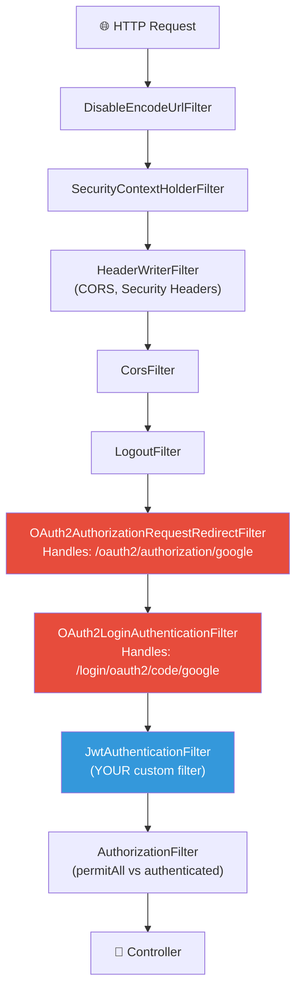

### What Each Filter Does

| Filter | Purpose | OAuth Role |
|--------|---------|------------|
| `OAuth2AuthorizationRequestRedirectFilter` | Intercepts `/oauth2/authorization/google` → redirects to Google | Starts OAuth flow |
| `OAuth2LoginAuthenticationFilter` | Intercepts `/login/oauth2/code/google` → exchanges code for token | Completes OAuth flow |
| `JwtAuthenticationFilter` | Checks `Authorization: Bearer <token>` header on all requests | Protects API endpoints |

### STATELESS Session Policy

```java
.sessionManagement(session -> session
    .sessionCreationPolicy(SessionCreationPolicy.STATELESS)
)
```

Matlab: Server koi HTTP session nahi banata. Har request mein JWT token hona chahiye. OAuth flow mein Spring Security temporarily session use karta hai (state parameter ke liye), lekin app ki normal requests STATELESS hain.

---

## 11. Challenges Faced & Solutions

### 🧅 Challenge 1: `CustomOAuth2UserService` Never Called

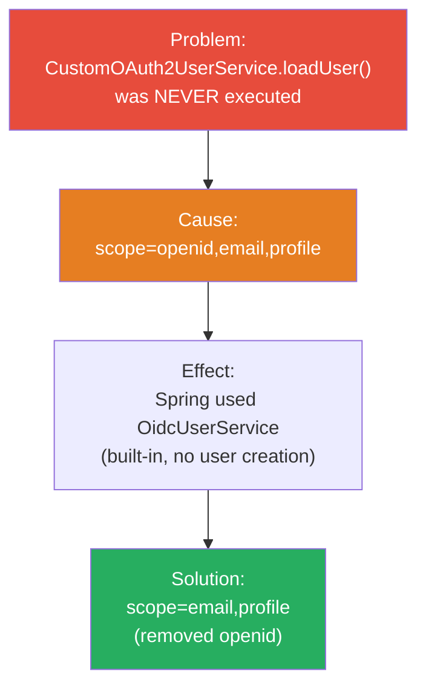

**How I Discovered It:**  
Backend logs mein `[OAUTH]` markers absent the. Spring Security log mein `OIDC_USER` dikha — matlab OIDC mode active tha.

**Why `openid` Was Problematic:**

| Scope Config | Spring Security Uses | Your Code Called? |
|---|---|---|
| `openid,email,profile` | `OidcUserService` (built-in) | ❌ NO |
| `email,profile` | `DefaultOAuth2UserService` (your custom) | ✅ YES |

**Fix:** One line in `application.properties`:
```diff
- scope=openid,email,profile
+ scope=email,profile
```

---

### 🧅 Challenge 2: Exceptions Were Invisible

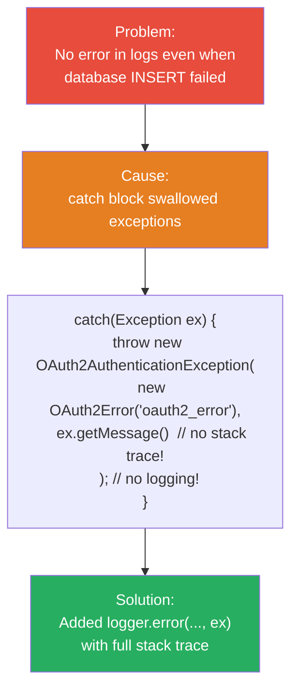

**How I Discovered It:**  
After fixing Challenge 1, the service was called but user still wasn't created. Logs showed entry into creation but no success/failure. Only after adding proper logging did the real error appear.

**Fix:**
```java
// BEFORE: Silent failure
catch (Exception ex) {
    throw new OAuth2AuthenticationException(new OAuth2Error("oauth2_error"), ex.getMessage());
}

// AFTER: Full visibility
catch (Exception ex) {
    logger.error("[OAUTH] EXCEPTION during OAuth2 processing", ex);  // FULL stack trace!
    throw new OAuth2AuthenticationException(new OAuth2Error("oauth2_error"), ex.getMessage(), ex);
}
```

---

### 🧅 Challenge 3: MySQL `password` Column NOT NULL

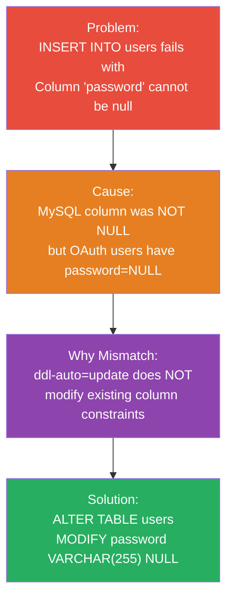

**How I Discovered It:**  
After fixing Challenges 1 and 2, the full stack trace finally appeared:
```
DataIntegrityViolationException: Column 'password' cannot be null
```

**Why It Happened:**
- `users` table was originally created for LOCAL users only → password was NOT NULL
- Later, OAuth was added → entity changed to `@Column(nullable = true)`  
- But `ddl-auto=update` **never** modifies existing column constraints!
- MySQL still had `password NOT NULL` while Java said `nullable = true`

**Fix:** Added migration in `DatabaseMigrationRunner.java`:
```java
jdbcTemplate.execute("ALTER TABLE users MODIFY COLUMN password VARCHAR(255) NULL");
```

---

### 🧅 Challenge 4: `save()` vs `saveAndFlush()` in Security Filter Context

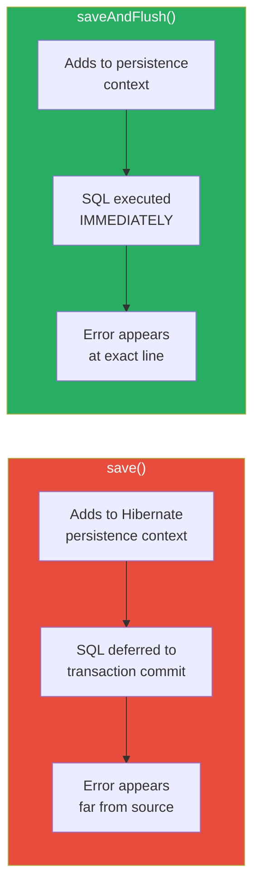

**Why `saveAndFlush()` Mattered:**
- `save()` Hibernate mein entity ko "managed" mark karta hai
- Actual SQL INSERT transaction commit pe hota hai
- Agar constraint fail hota, toh error **bahut baad mein** aata — confusing stack trace
- `saveAndFlush()` ne **turant** SQL execute karwaya → error **exact line** pe dikha

---

### Summary: Three Bugs Stacked Like an Onion

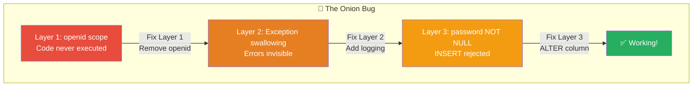

---

## 12. Testing Scenarios

### Scenario 1: New Google User ✅

| Step | Expected |
|------|----------|
| Click "Continue with Google" | Google consent screen opens |
| Select Google account | Redirect to frontend with `?code=UUID` |
| Frontend calls exchange API | JWT tokens returned |
| Check MySQL `users` table | Row exists: `auth_provider=GOOGLE`, `password=NULL`, `is_enabled=true` |
| Check MySQL `user_profiles` table | Row exists: `nickname=Google Name`, `level=1` |

### Scenario 2: Existing Google User (second login) ✅

| Step | Expected |
|------|----------|
| Login again with same Google account | No new row in `users` (no duplicate) |
| Logs show | `findByEmail — user exists: true` |
| Exchange API | JWT tokens returned |

### Scenario 3: LOCAL User With Same Email (rejection) ✅

| Step | Expected |
|------|----------|
| Register local account with email X | Local registration succeeds |
| Try Google login with same email X | **REJECTED** |
| Error message | "This email already belongs to a local account" |
| Frontend URL | `?error=This email already belongs to a local account...` |

### Scenario 4: Local Registration Still Works ✅

| Step | Expected |
|------|----------|
| POST /api/auth/register | "Registration successful! OTP sent." |
| POST /api/auth/verify-otp | "Account verified!" |
| POST /api/auth/login | JWT tokens returned |

---

## 13. Production Checklist

### Before Going Live

- [ ] Change `app.oauth.redirect-uri` to production frontend URL
- [ ] Set Google OAuth redirect URI in Google Cloud Console to production URL
- [ ] Remove debug logging:
  ```properties
  # Remove these after debugging:
  logging.level.org.hibernate.orm.jdbc.bind=TRACE
  logging.level.org.springframework.security.oauth2=DEBUG
  ```
- [ ] Ensure Redis is running and secured
- [ ] Ensure MySQL `password` column is nullable
- [ ] Set `spring.jpa.show-sql=false` in production
- [ ] Move secrets (client-secret, DB password) to environment variables
- [ ] Configure CORS for production domain only
- [ ] Enable HTTPS (OAuth2 requires it in production)

### Environment Variables to Set

```bash
# application.properties should use these:
FRONTEND_OAUTH_REDIRECT_URI=https://yourdomain.com/oauth2/callback
GOOGLE_CLIENT_ID=your-production-client-id
GOOGLE_CLIENT_SECRET=your-production-client-secret
DB_PASSWORD=your-production-db-password
REDIS_HOST=your-production-redis-host
```

---

> **This document covers the complete OAuth2 implementation in FriendsTogether — from concept to production. Every file, every flow, every bug, and every fix is documented here.**
