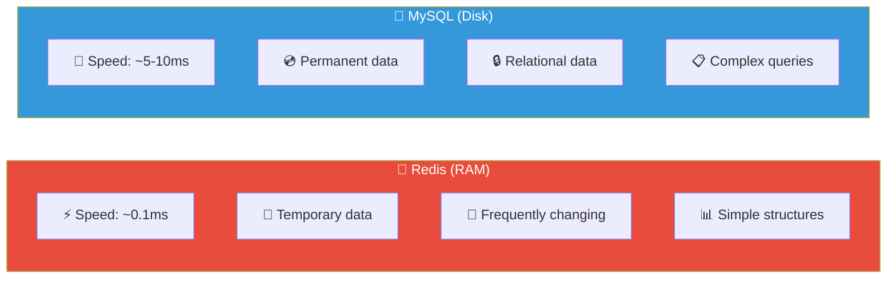
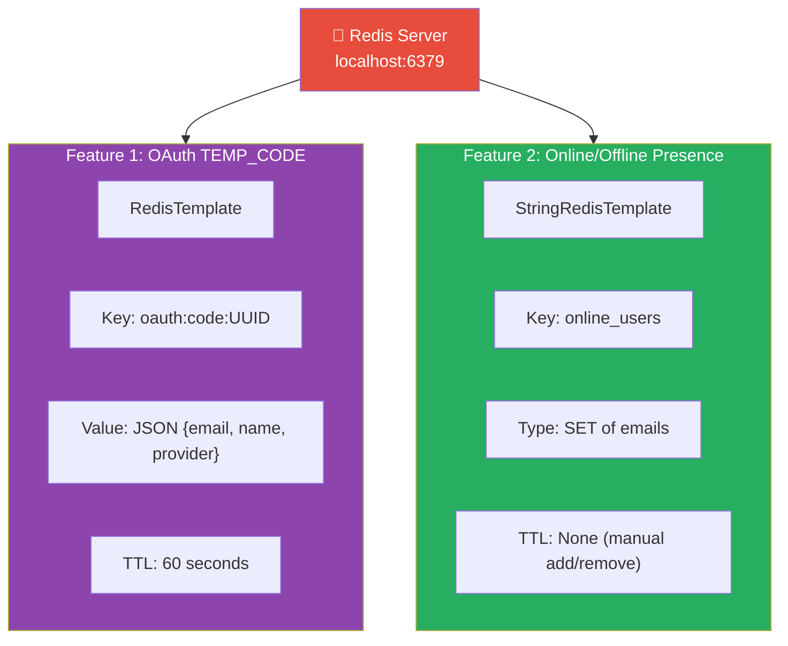
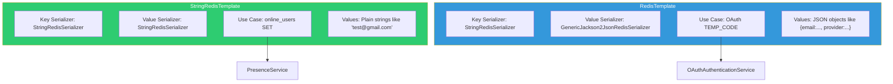
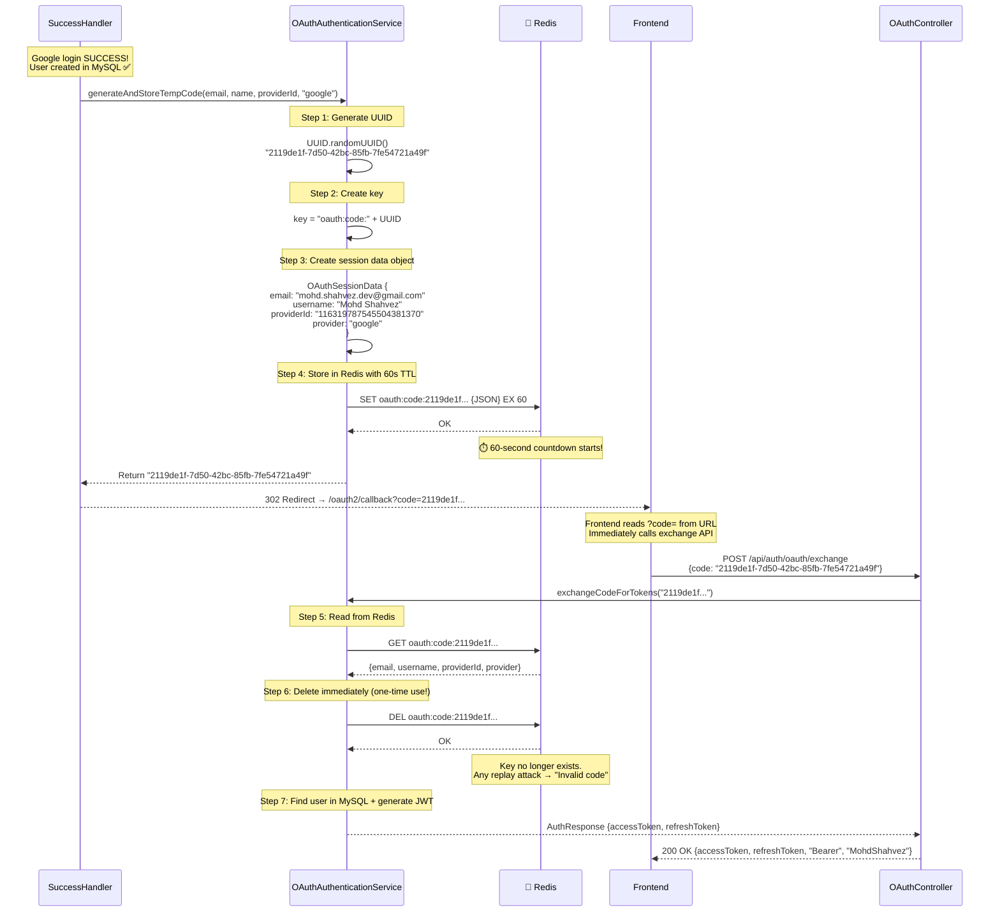
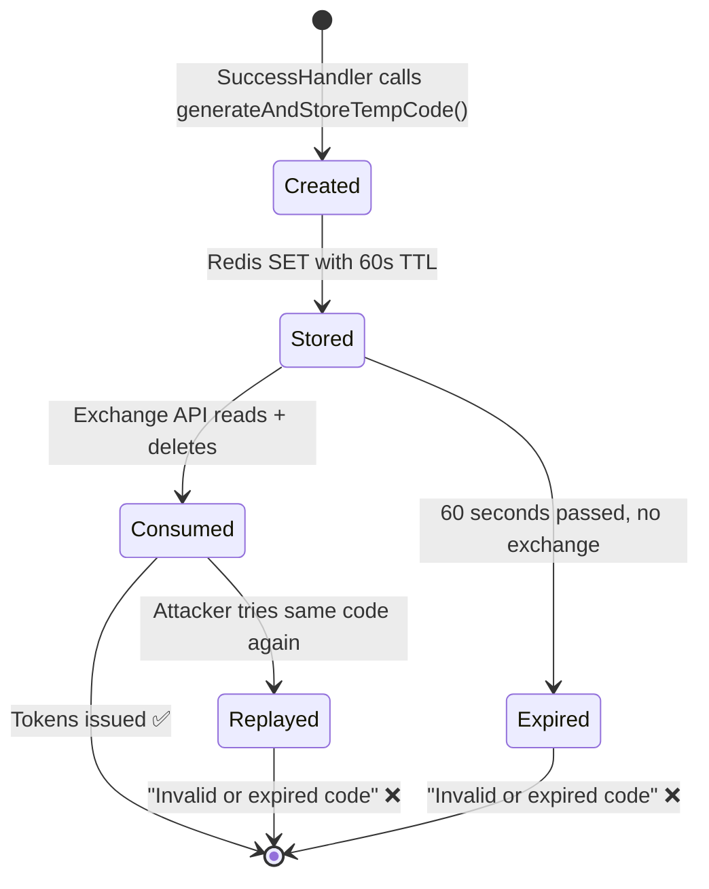
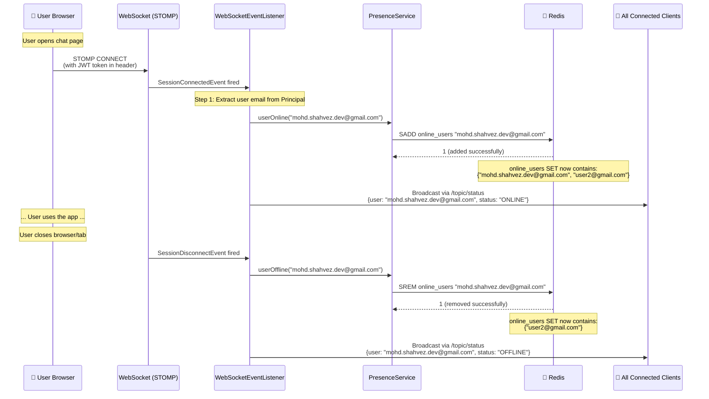
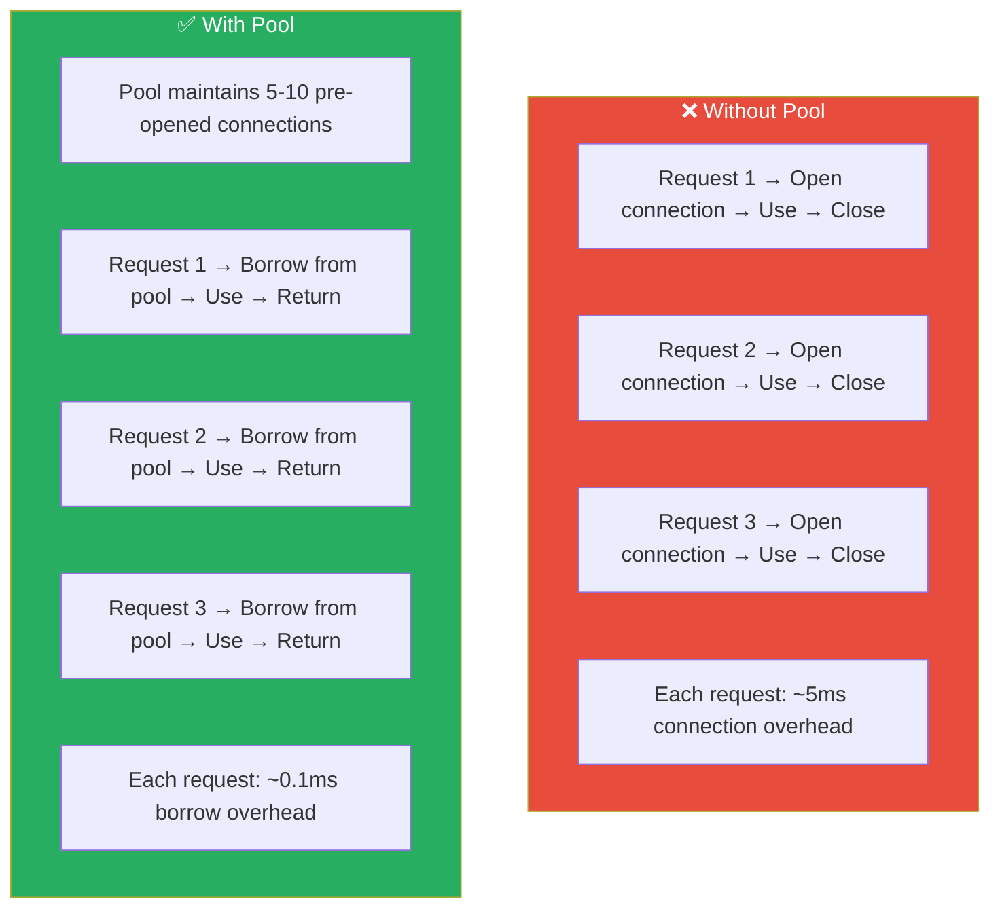
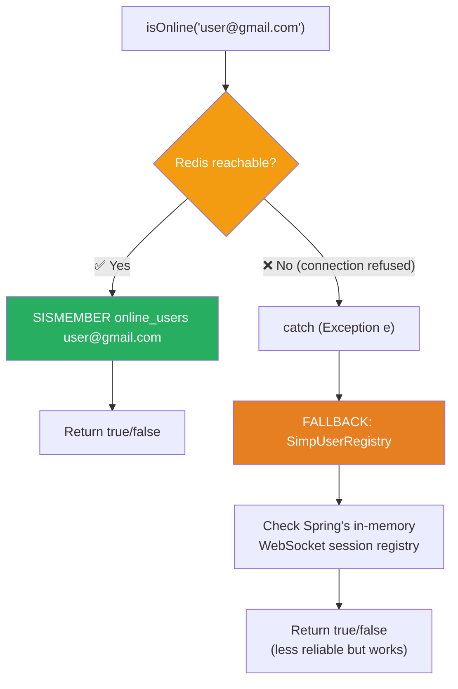

# 🔴 FriendsTogether — Complete Redis Implementation Guide

> **Project:** FriendsTogether Backend (Spring Boot 4 + Spring Data Redis)  
> **Author:** Mohd Shahvez  
> **Date:** June 2026  
> **Redis Version:** 7.x | **Client Library:** Lettuce (Spring Boot default)

---

## 📑 Table of Contents

1. [What is Redis?](#1-what-is-redis)
2. [Redis in FriendsTogether — Architecture Overview](#2-redis-in-friendstogether--architecture-overview)
3. [Redis Data Structures Used](#3-redis-data-structures-used)
4. [Setup & Configuration](#4-setup--configuration)
5. [Feature 1: OAuth2 TEMP_CODE (Token Exchange)](#5-feature-1-oauth2-temp_code-token-exchange)
6. [Feature 2: Online/Offline Presence (Chat)](#6-feature-2-onlineoffline-presence-chat)
7. [Complete Code — Every File Explained](#7-complete-code--every-file-explained)
8. [Redis CLI — Debug Commands](#8-redis-cli--debug-commands)
9. [TTL Deep Dive — How Expiry Works](#9-ttl-deep-dive--how-expiry-works)
10. [Serialization — How Java Objects Become Redis Data](#10-serialization--how-java-objects-become-redis-data)
11. [Connection Pooling (Lettuce)](#11-connection-pooling-lettuce)
12. [Error Handling & Fallback Strategy](#12-error-handling--fallback-strategy)
13. [Challenges Faced & Solutions](#13-challenges-faced--solutions)
14. [Production Best Practices](#14-production-best-practices)

---

## 1. What is Redis?

Redis = **RE**mote **DI**ctionary **S**erver

Ye ek **in-memory data store** hai — matlab saara data RAM mein hota hai (disk pe nahi). Isliye ye **bahut fast** hai — microseconds mein read/write karta hai.

### Redis vs MySQL — When to Use What?



| Feature | Redis | MySQL |
|---------|-------|-------|
| **Storage** | RAM (memory) | Disk (HDD/SSD) |
| **Speed** | ~0.1ms per read | ~5-10ms per read |
| **Data Loss** | Possible on restart (by default) | Never (ACID compliant) |
| **Best For** | Sessions, caches, presence, temp tokens | User accounts, messages, profiles |
| **Data Structure** | Key-Value, Sets, Lists, Hashes | Tables with rows & columns |
| **Query Language** | Simple commands (GET, SET, SADD) | SQL (SELECT, JOIN, WHERE) |

### Redis Data Types

```
┌──────────────────────────────────────────────────────────────┐
│                    REDIS DATA TYPES                          │
├─────────────┬────────────────────┬──────────────────────────┤
│ Type        │ Example            │ FriendsTogether Usage    │
├─────────────┼────────────────────┼──────────────────────────┤
│ STRING      │ SET key "value"    │ OAuth TEMP_CODE storage  │
│ SET         │ SADD key member    │ Online users tracking    │
│ HASH        │ HSET key f v       │ (future: user sessions)  │
│ LIST        │ LPUSH key value    │ (future: message queue)  │
│ SORTED SET  │ ZADD key score mem │ (future: leaderboards)   │
└─────────────┴────────────────────┴──────────────────────────┘
```

---

## 2. Redis in FriendsTogether — Architecture Overview

FriendsTogether mein Redis **2 critical features** ke liye use hota hai:



### Two Redis Templates — Why?



| Template | Value Format | Used By | Why This Template |
|----------|-------------|---------|------------------|
| `StringRedisTemplate` | Plain string (`"test@gmail.com"`) | `PresenceService` | SET operations need simple string members |
| `RedisTemplate<String, Object>` | JSON (`{"email":"test@gmail.com","provider":"google"}`) | `OAuthAuthenticationService` | Complex objects need JSON serialization |

---

## 3. Redis Data Structures Used

### Data Structure 1: STRING (OAuth TEMP_CODE)

```
┌─────────────────────────────────────────────────────────────────┐
│ Redis STRING with TTL                                            │
│                                                                  │
│ Key:   "oauth:code:2119de1f-7d50-42bc-85fb-7fe54721a49f"        │
│ Value: {                                                         │
│          "@class": "com.gaur.friendstogether.dto.OAuthSessionData"│
│          "email": "mohd.shahvez.dev@gmail.com",                  │
│          "username": "Mohd Shahvez",                             │
│          "providerId": "116319787545504381370",                  │
│          "provider": "google"                                    │
│        }                                                         │
│ TTL:   60 seconds (auto-delete after expiry)                    │
│                                                                  │
│ Redis Commands Equivalent:                                       │
│   SET oauth:code:UUID '{"email":"..."}' EX 60                   │
│   GET oauth:code:UUID                                            │
│   DEL oauth:code:UUID                                            │
│   TTL oauth:code:UUID → remaining seconds                       │
└─────────────────────────────────────────────────────────────────┘
```

### Data Structure 2: SET (Online Users)

```
┌─────────────────────────────────────────────────────────────────┐
│ Redis SET (unordered collection of unique strings)              │
│                                                                  │
│ Key:   "online_users"                                           │
│ Members:                                                         │
│   ┌─────────────────────────────────┐                           │
│   │ "mohd.shahvez.dev@gmail.com"    │                           │
│   │ "test.user@gmail.com"          │                           │
│   │ "friend123@yahoo.com"          │                           │
│   └─────────────────────────────────┘                           │
│ TTL:   None (members added/removed manually)                    │
│                                                                  │
│ Redis Commands Equivalent:                                       │
│   SADD online_users "mohd.shahvez.dev@gmail.com"  → user online │
│   SREM online_users "mohd.shahvez.dev@gmail.com"  → user offline│
│   SISMEMBER online_users "mohd.shahvez.dev@gmail.com" → true    │
│   SMEMBERS online_users → all online emails                     │
│   SCARD online_users → count of online users                    │
└─────────────────────────────────────────────────────────────────┘
```

---

## 4. Setup & Configuration

### Step 1: Install Redis

```bash
# Windows (using WSL or Docker)
docker run -d --name redis -p 6379:6379 redis:7-alpine

# Ubuntu/Debian
sudo apt update && sudo apt install redis-server
sudo systemctl start redis

# macOS
brew install redis && brew services start redis

# Verify Redis is running
redis-cli ping
# Expected output: PONG
```

### Step 2: Maven Dependencies

```xml
<!-- pom.xml -->
<dependency>
    <groupId>org.springframework.boot</groupId>
    <artifactId>spring-boot-starter-data-redis</artifactId>
</dependency>

<!-- Connection pool (recommended for production) -->
<dependency>
    <groupId>org.apache.commons</groupId>
    <artifactId>commons-pool2</artifactId>
</dependency>
```

### Step 3: Application Properties

```properties
# ===============================
# Redis Configuration
# ===============================

# Connection
spring.data.redis.host=localhost          # Redis server address
spring.data.redis.port=6379              # Redis default port
spring.data.redis.timeout=60s            # Connection timeout

# Connection Pool (Lettuce - Spring Boot default client)
spring.data.redis.lettuce.pool.max-active=10   # Max connections in pool
spring.data.redis.lettuce.pool.max-idle=5      # Max idle connections
spring.data.redis.lettuce.pool.min-idle=1      # Min idle connections kept alive

# Production additions (uncomment when needed):
# spring.data.redis.password=your-redis-password
# spring.data.redis.ssl.enabled=true
```

### Step 4: RedisConfig.java — Complete Code

```java
// File: config/RedisConfig.java
// Purpose: Configure TWO Redis templates for different serialization needs

@Slf4j
@Configuration
public class RedisConfig {

    /**
     * TEMPLATE 1: StringRedisTemplate
     * For: PresenceService (online_users SET)
     * Serialization: String → String (plain text)
     * 
     * Why separate? SET members must be plain strings.
     * If we used JSON serializer, "test@gmail.com" would become
     * "\"test@gmail.com\"" (with extra quotes) — causing lookup failures.
     */
    @Bean
    public StringRedisTemplate stringRedisTemplate(RedisConnectionFactory connectionFactory) {
        log.info("[REDIS] Configuring StringRedisTemplate for Presence tracking");
        StringRedisTemplate template = new StringRedisTemplate(connectionFactory);
        template.afterPropertiesSet();
        log.info("[REDIS] StringRedisTemplate configured successfully");
        return template;
    }

    /**
     * TEMPLATE 2: RedisTemplate<String, Object>
     * For: OAuthAuthenticationService (TEMP_CODE storage)
     * Serialization: String key → JSON value
     *
     * GenericJackson2JsonRedisSerializer adds "@class" type info
     * so it can deserialize back to the correct Java class.
     */
    @Bean
    public RedisTemplate<String, Object> redisTemplate(RedisConnectionFactory connectionFactory) {
        log.info("[REDIS] Configuring RedisTemplate<String, Object> for JSON payloads");

        RedisTemplate<String, Object> template = new RedisTemplate<>();
        template.setConnectionFactory(connectionFactory);

        // Keys: Always plain strings ("oauth:code:UUID")
        StringRedisSerializer stringSerializer = new StringRedisSerializer();
        template.setKeySerializer(stringSerializer);
        template.setHashKeySerializer(stringSerializer);

        // Values: JSON with type info (for OAuthSessionData, etc.)
        RedisSerializer<Object> jsonSerializer = RedisSerializer.json();
        template.setValueSerializer(jsonSerializer);
        template.setHashValueSerializer(jsonSerializer);

        template.afterPropertiesSet();
        log.info("[REDIS] RedisTemplate configured successfully");
        return template;
    }
}
```

---

## 5. Feature 1: OAuth2 TEMP_CODE (Token Exchange)

### Complete Flow — Step by Step



### TEMP_CODE Lifecycle



### generateAndStoreTempCode() — Code Breakdown

```java
// File: OAuthAuthenticationService.java

public String generateAndStoreTempCode(String email, String username, 
                                        String providerId, String provider) {
    // 1. Generate cryptographically random UUID
    //    Example: "2119de1f-7d50-42bc-85fb-7fe54721a49f"
    String tempCode = UUID.randomUUID().toString();
    
    // 2. Build Redis key with "oauth:code:" prefix
    //    This prefix groups all OAuth codes together for easy management
    //    Example: "oauth:code:2119de1f-7d50-42bc-85fb-7fe54721a49f"
    String key = "oauth:code:" + tempCode;
    
    // 3. Build session data DTO
    //    This is what gets stored in Redis as JSON
    OAuthSessionData sessionData = new OAuthSessionData(email, username, providerId, provider);
    
    // 4. Store in Redis with TTL
    //    redisTemplate.opsForValue() → access STRING operations
    //    .set(key, value, timeout, unit) → SET key value EX timeout
    //
    //    Internally this executes:
    //    SET "oauth:code:2119de1f..." '{"@class":"...OAuthSessionData","email":"mohd.shahvez.dev@gmail.com",...}' EX 60
    redisTemplate.opsForValue().set(key, sessionData, 60, TimeUnit.SECONDS);
    
    logger.info("[OAUTH-EXCHANGE] Stored TEMP_CODE in Redis — key: {}, email: {}", key, email);
    
    // 5. Return only the UUID to the caller (not the full key)
    //    The "oauth:code:" prefix is added back when reading
    return tempCode;
}
```

### exchangeCodeForTokens() — Code Breakdown

```java
// File: OAuthAuthenticationService.java

public AuthResponse exchangeCodeForTokens(String tempCode) {
    logger.info("[OAUTH-EXCHANGE] ===== exchangeCodeForTokens() CALLED =====");
    
    // 1. Reconstruct the Redis key
    String key = "oauth:code:" + tempCode;
    
    // 2. Read from Redis
    //    opsForValue().get(key) → Redis command: GET key
    //    Returns: the Java object (OAuthSessionData) or LinkedHashMap
    Object rawData = redisTemplate.opsForValue().get(key);
    
    // 3. Check if key exists
    //    null means either:
    //    a) TTL expired (60 seconds passed) — auto-deleted by Redis
    //    b) Already consumed (we deleted it in a previous exchange)
    //    c) Invalid UUID (never existed)
    if (rawData == null) {
        logger.error("[OAUTH-EXCHANGE] Redis key NOT FOUND or EXPIRED: {}", key);
        throw new RuntimeException("Error: Invalid or expired authorization code.");
    }
    
    // 4. Deserialize the Redis value
    //    GenericJackson2JsonRedisSerializer may return:
    //    a) OAuthSessionData directly (if @class type info is preserved)
    //    b) LinkedHashMap (if type info is lost/different classloader)
    //    We handle BOTH cases for robustness
    OAuthSessionData sessionData;
    if (rawData instanceof OAuthSessionData) {
        sessionData = (OAuthSessionData) rawData;
    } else {
        // Fallback: Convert LinkedHashMap → OAuthSessionData via Jackson
        ObjectMapper mapper = new ObjectMapper();
        sessionData = mapper.convertValue(rawData, OAuthSessionData.class);
    }
    
    logger.info("[OAUTH-EXCHANGE] Session email: '{}'", sessionData.getEmail());
    
    // 5. DELETE the key immediately — ONE-TIME USE!
    //    Redis command: DEL key
    //    This prevents replay attacks:
    //    Even if someone intercepts the UUID, it can only be used ONCE
    redisTemplate.delete(key);
    
    // 6. Find user in MySQL using the email from Redis
    User user = userRepository.findByEmail(sessionData.getEmail())
            .orElseThrow(() -> new RuntimeException("Error: User not found during token exchange."));
    
    // 7. Generate JWT tokens
    String accessToken = jwtUtil.generateToken(user.getEmail());
    String refreshToken = jwtUtil.generateRefreshToken(user.getEmail());
    
    return AuthResponse.builder()
            .accessToken(accessToken)
            .refreshToken(refreshToken)
            .tokenType("Bearer")
            .username(user.getUsername())
            .build();
}
```

### OAuthSessionData.java — Redis DTO

```java
// File: dto/OAuthSessionData.java
// Purpose: Data Transfer Object stored in Redis as JSON

@Data                   // Lombok: getters, setters, toString, equals, hashCode
@AllArgsConstructor     // Constructor with all fields
@NoArgsConstructor      // No-arg constructor (required for Jackson deserialization!)
public class OAuthSessionData implements Serializable {
    private String email;       // "mohd.shahvez.dev@gmail.com"
    private String username;    // "Mohd Shahvez"  
    private String providerId;  // "116319787545504381370" (Google's sub)
    private String provider;    // "google"
}

// When stored in Redis, it looks like this JSON:
// {
//   "@class": "com.gaur.friendstogether.dto.OAuthSessionData",
//   "email": "mohd.shahvez.dev@gmail.com",
//   "username": "Mohd Shahvez",
//   "providerId": "116319787545504381370",
//   "provider": "google"
// }
//
// The "@class" field is added by GenericJackson2JsonRedisSerializer
// for automatic type detection during deserialization.
```

---

## 6. Feature 2: Online/Offline Presence (Chat)

### Complete Flow — WebSocket + Redis



### PresenceService.java — Complete Code with Explanation

```java
// File: service/PresenceService.java
// Purpose: Manage user online/offline status using Redis SET

@Service
@RequiredArgsConstructor
@Slf4j
public class PresenceService {

    // StringRedisTemplate: For plain string operations (not JSON)
    private final StringRedisTemplate stringRedisTemplate;
    
    // Fallback: Spring's in-memory WebSocket user registry
    private final SimpUserRegistry simpUserRegistry;

    // Redis key for the online users SET
    // This is a SINGLE key that contains ALL online user emails
    private static final String ONLINE_USERS_KEY = "online_users";

    /**
     * Mark user as ONLINE
     * Redis command: SADD online_users "mohd.shahvez.dev@gmail.com"
     * 
     * SADD = Set ADD — adds a member to a SET
     * If member already exists, SADD does nothing (idempotent)
     * Returns: 1 if added, 0 if already exists
     */
    public void userOnline(String email) {
        log.info("[PRESENCE] User ONLINE: {}", email);
        try {
            stringRedisTemplate.opsForSet().add(ONLINE_USERS_KEY, email);
            // opsForSet() → access Redis SET operations
            // .add(key, value) → SADD key value
        } catch (Exception e) {
            // Redis down? Log but don't crash the app
            log.warn("[REDIS] Failure during userOnline for '{}'. Error: {}", email, e.getMessage());
        }
    }

    /**
     * Mark user as OFFLINE
     * Redis command: SREM online_users "mohd.shahvez.dev@gmail.com"
     * 
     * SREM = Set REMove — removes a member from a SET
     * If member doesn't exist, SREM does nothing (idempotent)
     * Returns: 1 if removed, 0 if not found
     */
    public void userOffline(String email) {
        log.info("[PRESENCE] User OFFLINE: {}", email);
        try {
            stringRedisTemplate.opsForSet().remove(ONLINE_USERS_KEY, email);
        } catch (Exception e) {
            log.warn("[REDIS] Failure during userOffline for '{}'. Error: {}", email, e.getMessage());
        }
    }

    /**
     * Check if a specific user is online
     * Redis command: SISMEMBER online_users "mohd.shahvez.dev@gmail.com"
     * 
     * SISMEMBER = Set IS MEMBER — checks if value exists in SET
     * Returns: true if member exists, false if not
     * Time complexity: O(1) — constant time regardless of SET size!
     */
    public boolean isOnline(String email) {
        try {
            Boolean isMember = stringRedisTemplate.opsForSet().isMember(ONLINE_USERS_KEY, email);
            return Boolean.TRUE.equals(isMember);
        } catch (Exception e) {
            // FALLBACK: If Redis is down, check Spring's in-memory registry
            log.warn("[REDIS] Unreachable. Falling back to SimpUserRegistry");
            return simpUserRegistry.getUser(email) != null;
        }
    }

    /**
     * Get ALL online users
     * Redis command: SMEMBERS online_users
     * 
     * SMEMBERS = Set MEMBERS — returns ALL members of a SET
     * Returns: Set<String> of all online user emails
     * Use case: Admin dashboard, discovery feature
     */
    public Set<String> getOnlineUsers() {
        try {
            Set<String> users = stringRedisTemplate.opsForSet().members(ONLINE_USERS_KEY);
            return users != null ? users : Collections.emptySet();
        } catch (Exception e) {
            log.warn("[REDIS] Failure fetching online users");
            return Collections.emptySet();
        }
    }

    /**
     * Bulk status check — check multiple users at once
     * Use case: Friend list page (show green dot for online friends)
     * 
     * Calls isOnline() for each email
     * Returns: Map<"test@gmail.com", true/false>
     */
    public Map<String, Boolean> getBulkStatus(Set<String> emails) {
        if (emails == null || emails.isEmpty()) {
            return Collections.emptyMap();
        }
        return emails.stream()
                .collect(Collectors.toMap(email -> email, this::isOnline));
    }
}
```

### PresenceController.java — REST API

```java
// File: controller/PresenceController.java
// Base URL: /api/chat/presence

@RestController
@RequestMapping("/api/chat/presence")
public class PresenceController {

    // 1. Single user status
    // GET /api/chat/presence/status/test@gmail.com
    // Response: true or false
    @GetMapping("/status/{email:.+}")       // {email:.+} allows dots in email!
    public ResponseEntity<Boolean> getStatus(@PathVariable String email);

    // 2. Bulk status check (for friend lists)
    // POST /api/chat/presence/bulk-status
    // Body: ["user1@gmail.com", "user2@gmail.com", "user3@gmail.com"]
    // Response: {"user1@gmail.com": true, "user2@gmail.com": false, "user3@gmail.com": true}
    @PostMapping("/bulk-status")
    public ResponseEntity<Map<String, Boolean>> getBulkStatus(@RequestBody Set<String> emails);

    // 3. Online user count
    // GET /api/chat/presence/online-count
    // Response: 42
    @GetMapping("/online-count")
    public ResponseEntity<Integer> getOnlineCount();

    // 4. All online users (admin)
    // GET /api/chat/presence/list-all
    // Response: ["user1@gmail.com", "user2@gmail.com", ...]
    @GetMapping("/list-all")
    public ResponseEntity<Set<String>> getAllOnlineUsers();
}
```

### WebSocketEventListener.java — Auto Online/Offline

```java
// File: security/config/WebSocketEventListener.java
// Purpose: Automatically update Redis when users connect/disconnect via WebSocket

@Component
@RequiredArgsConstructor
public class WebSocketEventListener {

    private final PresenceService presenceService;
    private final SimpMessagingTemplate messagingTemplate;
    private final ChatService chatService;

    /**
     * Fires when user successfully connects via STOMP WebSocket
     * 
     * What happens:
     * 1. Redis: SADD online_users "user@gmail.com"
     * 2. Broadcast: /topic/status → {user: "user@gmail.com", status: "ONLINE"}
     * 3. Deliver any pending offline messages
     */
    @EventListener
    public void handleWebSocketConnectListener(SessionConnectedEvent event) {
        String userEmail = accessor.getUser().getName();  // From JWT
        
        presenceService.userOnline(userEmail);             // → Redis SADD
        
        // Broadcast to ALL connected clients
        PresenceEvent event = PresenceEvent.builder()
                .user(userEmail)
                .status("ONLINE")
                .build();
        messagingTemplate.convertAndSend("/topic/status", event);
        
        // Deliver queued offline messages
        chatService.deliverPendingMessages(userEmail);
    }

    /**
     * Fires when user disconnects (closes tab, loses connection, etc.)
     * 
     * What happens:
     * 1. Redis: SREM online_users "user@gmail.com"
     * 2. Broadcast: /topic/status → {user: "user@gmail.com", status: "OFFLINE"}
     */
    @EventListener
    public void handleWebSocketDisconnectListener(SessionDisconnectEvent event) {
        String userEmail = accessor.getUser().getName();
        
        presenceService.userOffline(userEmail);            // → Redis SREM
        
        PresenceEvent event = PresenceEvent.builder()
                .user(userEmail)
                .status("OFFLINE")
                .build();
        messagingTemplate.convertAndSend("/topic/status", event);
    }
}
```

---

## 7. Complete Code — Every File Explained

### File Map

```
src/main/java/com/gaur/friendstogether/
│
├── config/
│   └── RedisConfig.java               ← Two Redis templates configured here
│
├── dto/
│   ├── OAuthSessionData.java          ← DTO for Redis OAuth storage
│   └── response/
│       └── PresenceEvent.java         ← DTO for WebSocket broadcast
│
├── service/
│   ├── PresenceService.java           ← Online/offline (Redis SET)
│   └── OAuthAuthenticationService.java ← TEMP_CODE (Redis STRING + TTL)
│
├── controller/
│   └── PresenceController.java        ← REST API for presence queries
│
├── security/
│   ├── config/
│   │   └── WebSocketEventListener.java ← Auto online/offline on WS connect/disconnect
│   └── oauth2/
│       └── OAuth2AuthenticationSuccessHandler.java ← Stores TEMP_CODE after Google login
│
└── resources/
    └── application.properties          ← Redis connection settings
```

---

## 8. Redis CLI — Debug Commands

### How to Open Redis CLI

```bash
# Open Redis CLI
redis-cli

# If Redis has a password
redis-cli -a your-password

# If Redis is on a different host/port
redis-cli -h 192.168.1.100 -p 6380
```

### 🔍 OAuth TEMP_CODE — Debug Commands

```bash
# ═══════════════════════════════════════════════════════════════
# OAUTH TEMP_CODE DEBUGGING
# ═══════════════════════════════════════════════════════════════

# 1. See all OAuth temp codes currently in Redis
KEYS oauth:code:*
# Output: 
# 1) "oauth:code:2119de1f-7d50-42bc-85fb-7fe54721a49f"
# 2) "oauth:code:a3b4c5d6-e7f8-9012-3456-789012345678"
# (empty if no active codes)

# 2. Read a specific temp code's data
GET "oauth:code:2119de1f-7d50-42bc-85fb-7fe54721a49f"
# Output:
# {"@class":"com.gaur.friendstogether.dto.OAuthSessionData",
#  "email":"mohd.shahvez.dev@gmail.com",
#  "username":"Mohd Shahvez",
#  "providerId":"116319787545504381370",
#  "provider":"google"}

# 3. Check remaining TTL (Time To Live)
TTL "oauth:code:2119de1f-7d50-42bc-85fb-7fe54721a49f"
# Output:
#  45    → 45 seconds remaining
#  -1    → No expiry set (shouldn't happen for OAuth codes)
#  -2    → Key does not exist (expired or deleted)

# 4. Check TTL in milliseconds (more precise)
PTTL "oauth:code:2119de1f-7d50-42bc-85fb-7fe54721a49f"
# Output: 44523 (44.5 seconds remaining)

# 5. Manually delete a temp code (for testing)
DEL "oauth:code:2119de1f-7d50-42bc-85fb-7fe54721a49f"
# Output: (integer) 1

# 6. Check the data type of a key
TYPE "oauth:code:2119de1f-7d50-42bc-85fb-7fe54721a49f"
# Output: string

# 7. Set a test OAuth code manually (for testing exchange endpoint)
SET "oauth:code:test-code-123" '{"@class":"com.gaur.friendstogether.dto.OAuthSessionData","email":"test@gmail.com","username":"Test User","providerId":"12345","provider":"google"}' EX 300
# Creates a test code with 5-minute TTL

# 8. Count how many OAuth codes exist
# (useful to detect if codes are leaking / not being cleaned up)
eval "return #redis.call('keys','oauth:code:*')" 0
# Output: (integer) 2
```

### 🟢 Online/Offline Presence — Debug Commands

```bash
# ═══════════════════════════════════════════════════════════════
# ONLINE/OFFLINE PRESENCE DEBUGGING
# ═══════════════════════════════════════════════════════════════

# 1. See ALL online users
SMEMBERS online_users
# Output:
# 1) "mohd.shahvez.dev@gmail.com"
# 2) "test.user@gmail.com"
# 3) "friend123@yahoo.com"

# 2. Count online users
SCARD online_users
# Output: (integer) 3

# 3. Check if a specific user is online
SISMEMBER online_users "mohd.shahvez.dev@gmail.com"
# Output:
#  (integer) 1  → ONLINE
#  (integer) 0  → OFFLINE

# 4. Manually add a user as online (for testing)
SADD online_users "manual-test@gmail.com"
# Output: (integer) 1

# 5. Manually remove a user (simulate disconnect)
SREM online_users "manual-test@gmail.com"
# Output: (integer) 1

# 6. Clear ALL online users (nuclear option — for debugging)
DEL online_users
# Output: (integer) 1
# WARNING: This marks everyone as offline!

# 7. Check if the online_users key exists
EXISTS online_users
# Output:
#  (integer) 1  → exists (at least 1 user online)
#  (integer) 0  → doesn't exist (no one online, or key deleted)

# 8. Get a random online user (for testing)
SRANDMEMBER online_users
# Output: "mohd.shahvez.dev@gmail.com"

# 9. Get multiple random online users
SRANDMEMBER online_users 3
# Output: 3 random online user emails
```

### 🔧 General Redis Debug Commands

```bash
# ═══════════════════════════════════════════════════════════════
# GENERAL REDIS COMMANDS
# ═══════════════════════════════════════════════════════════════

# 1. Check if Redis is alive
PING
# Output: PONG

# 2. See ALL keys in Redis (use carefully in production!)
KEYS *
# Output:
# 1) "online_users"
# 2) "oauth:code:2119de1f-..."

# 3. See total number of keys
DBSIZE
# Output: (integer) 2

# 4. Get Redis server info (memory, clients, etc.)
INFO
# Or specific section:
INFO memory
INFO clients
INFO stats

# 5. See memory usage of a specific key
MEMORY USAGE "online_users"
# Output: (integer) 128  (bytes)

# 6. Monitor ALL Redis commands in real-time
# (VERY useful for debugging — shows every command as it executes)
MONITOR
# Output (live):
# 1686700000.123 [0 127.0.0.1:12345] "SET" "oauth:code:abc" "..."
# 1686700001.456 [0 127.0.0.1:12345] "SADD" "online_users" "test@gmail.com"
# Press Ctrl+C to stop

# 7. See connected clients
CLIENT LIST
# Output: Shows all connected applications

# 8. Flush ALL data (DANGEROUS — development only!)
FLUSHALL
# Output: OK (everything deleted!)

# 9. See slow queries (performance debugging)
SLOWLOG GET 10
# Shows last 10 slow queries
```

### 🧪 Complete Testing Script

```bash
# ═══════════════════════════════════════════════════════════════
# FULL TEST SCRIPT — Run after Google OAuth login
# ═══════════════════════════════════════════════════════════════

echo "=== Step 1: Check for OAuth temp codes ==="
redis-cli KEYS "oauth:code:*"

echo ""
echo "=== Step 2: Check online users ==="
redis-cli SMEMBERS online_users

echo ""
echo "=== Step 3: Count online users ==="
redis-cli SCARD online_users

echo ""
echo "=== Step 4: Check specific user online status ==="
redis-cli SISMEMBER online_users "mohd.shahvez.dev@gmail.com"

echo ""
echo "=== Step 5: Total keys in Redis ==="
redis-cli DBSIZE

echo ""
echo "=== Step 6: Redis memory usage ==="
redis-cli INFO memory | grep "used_memory_human"
```

---

## 9. TTL Deep Dive — How Expiry Works

### What is TTL?

TTL = **T**ime **T**o **L**ive — Redis automatically deletes a key after TTL expires.


### TTL in FriendsTogether Code

```java
// OAuth TEMP_CODE: 60 seconds TTL
redisTemplate.opsForValue().set(key, sessionData, 60, TimeUnit.SECONDS);
//                                                 ^^^^^^^^^^^^^^^^^^
//                                                 Redis: SET key value EX 60

// Online users SET: NO TTL (managed manually)
stringRedisTemplate.opsForSet().add(ONLINE_USERS_KEY, email);
//                                                    No TTL parameter
//                                                    Members stay until SREM
```

### Redis Expiry Mechanism — How It Actually Works

```
Redis uses TWO strategies for key expiration:

1. LAZY EXPIRATION (default)
   ┌─────────────────────────────────────────┐
   │ When someone tries to GET an expired key │
   │ Redis checks: "Is TTL expired?"          │
   │ If yes → Delete key, return nil          │
   │ If no  → Return value normally           │
   └─────────────────────────────────────────┘
   
2. ACTIVE EXPIRATION (background)
   ┌─────────────────────────────────────────┐
   │ Redis periodically (10 times/second):    │
   │ 1. Randomly samples 20 keys with TTL    │
   │ 2. Deletes the expired ones             │
   │ 3. If > 25% were expired, repeat        │
   └─────────────────────────────────────────┘

Result: Expired keys are deleted within ~1 second of expiry.
No memory leak! No stale data!
```

### Why 60 Seconds for OAuth?

```
Too Short (5s):   User might not reach exchange API in time
                  (slow network, frontend loading)

Too Long (300s):  Larger attack window for code interception
                  More stale codes sitting in Redis memory

60 Seconds:       ✅ Enough for frontend redirect + API call (~2-3 seconds)
                  ✅ Short enough to limit security risk
                  ✅ Industry standard for authorization codes
```

---

## 10. Serialization — How Java Objects Become Redis Data

### Serialization Flow

```mermaid
flowchart LR
    subgraph JAVA["☕ Java Side"]
        J1["OAuthSessionData {<br/>  email: 'test@gmail.com'<br/>  provider: 'google'<br/>}"]
    end

    subgraph SERIALIZE["🔄 Serialization"]
        S1["GenericJackson2Json<br/>RedisSerializer"]
    end

    subgraph REDIS["🔴 Redis Side"]
        R1['"{"@class":"...OAuthSessionData",<br/>"email":"test@gmail.com",<br/>"provider":"google"}"']
    end

    J1 --> |".set()"| S1
    S1 --> |"Java → JSON bytes"| R1
    R1 --> |".get()"| S1
    S1 --> |"JSON bytes → Java"| J1

    style JAVA fill:#e67e22,color:#fff
    style SERIALIZE fill:#3498db,color:#fff
    style REDIS fill:#e74c3c,color:#fff
```

### Two Serializers Compared

```
StringRedisSerializer (for Presence):
┌────────────────────────────────────────────┐
│ Java: "test@gmail.com"                     │
│   ↓ serialize                              │
│ Redis: test@gmail.com                      │
│   ↓ deserialize                            │
│ Java: "test@gmail.com"                     │
│                                            │
│ Simple. No type info. No JSON wrapping.    │
└────────────────────────────────────────────┘

GenericJackson2JsonRedisSerializer (for OAuth):
┌──────────────────────────────────────────────────────────┐
│ Java: OAuthSessionData {email:"test@gmail.com", ...}     │
│   ↓ serialize                                            │
│ Redis: {"@class":"com.gaur...OAuthSessionData",          │
│         "email":"test@gmail.com",                        │
│         "provider":"google"}                             │
│   ↓ deserialize                                          │
│ Java: OAuthSessionData {email:"test@gmail.com", ...}     │
│                                                          │
│ Includes "@class" for automatic type detection.          │
│ Can handle ANY Java object, not just strings.            │
└──────────────────────────────────────────────────────────┘
```

### The LinkedHashMap Problem & Solution

```java
// When reading from Redis, GenericJackson2JsonRedisSerializer 
// SOMETIMES returns a LinkedHashMap instead of OAuthSessionData.
// This happens when:
// 1. Classloader differences (hot-reload / devtools restart)
// 2. @class field doesn't match current classpath

// That's why we have this safety check:
Object rawData = redisTemplate.opsForValue().get(key);

if (rawData instanceof OAuthSessionData) {
    // Happy path: proper deserialization
    sessionData = (OAuthSessionData) rawData;
} else {
    // Fallback: manual conversion from LinkedHashMap
    ObjectMapper mapper = new ObjectMapper();
    sessionData = mapper.convertValue(rawData, OAuthSessionData.class);
}
```

---

## 11. Connection Pooling (Lettuce)

### What is Connection Pooling?



### Configuration

```properties
# Lettuce Connection Pool
spring.data.redis.lettuce.pool.max-active=10   # Max total connections
spring.data.redis.lettuce.pool.max-idle=5      # Max idle (unused) connections
spring.data.redis.lettuce.pool.min-idle=1      # Keep at least 1 ready
```

---

## 12. Error Handling & Fallback Strategy

### PresenceService — Graceful Degradation



```java
// Every Redis call is wrapped in try-catch
// If Redis is down, the app STILL WORKS (degraded mode)
public boolean isOnline(String email) {
    try {
        return Boolean.TRUE.equals(
            stringRedisTemplate.opsForSet().isMember(ONLINE_USERS_KEY, email)
        );
    } catch (Exception e) {
        // FALLBACK to Spring's in-memory WebSocket registry
        log.warn("[REDIS] Unreachable. Falling back to SimpUserRegistry");
        return simpUserRegistry.getUser(email) != null;
    }
}
```

### OAuthAuthenticationService — Fail-Fast

```java
// OAuth has NO fallback — if Redis is down, OAuth login FAILS
// This is intentional: security-critical flow must not degrade silently
Object rawData = redisTemplate.opsForValue().get(key);
if (rawData == null) {
    throw new RuntimeException("Error: Invalid or expired authorization code.");
    // No fallback — user must retry Google login
}
```

---

## 13. Challenges Faced & Solutions

### Challenge 1: Two Redis Templates Conflicting

```
Problem: Spring Boot auto-configures RedisTemplate<String, Object>
         We also needed StringRedisTemplate for PresenceService
         Spring couldn't decide which to inject

Solution: Explicitly define BOTH beans in RedisConfig.java
          with @Bean annotation. Spring Boot's auto-config
          backs off when you define your own beans.
```

### Challenge 2: OAuthSessionData Deserialized as LinkedHashMap

```
Problem: After Spring DevTools hot-reload, Redis returned
         LinkedHashMap instead of OAuthSessionData

Root Cause: DevTools uses a separate classloader.
            The @class in Redis JSON points to
            OAuthSessionData loaded by the OLD classloader.
            New classloader can't find it → falls back to LinkedHashMap.

Solution: Added instanceof check + ObjectMapper fallback:
          if (rawData instanceof OAuthSessionData) → use directly
          else → ObjectMapper.convertValue() to convert
```

### Challenge 3: Email Dots in Path Variables

```
Problem: GET /api/chat/presence/status/test.user@gmail.com
         Spring treated ".com" as file extension and trimmed it!
         Received email: "test.user@gmail" (missing .com)

Solution: Use regex in @PathVariable:
          @GetMapping("/status/{email:.+}")
          The ".+" tells Spring to include dots in the variable
```

### Challenge 4: Redis SET vs STRING for Online Users

```
Problem: Should we use STRING (one key per user) or SET (one key for all)?

Option A — STRING per user:
  SET "user:online:test@gmail.com" "true" EX 300
  → Pro: Auto-expiry per user
  → Con: Need KEYS pattern scan to list all (O(N), slow!)

Option B — SET with all users (CHOSEN ✅):
  SADD "online_users" "test@gmail.com"
  → Pro: SMEMBERS returns all online users in O(N)
  → Pro: SISMEMBER checks in O(1) — instant!
  → Pro: SCARD counts in O(1) — instant!
  → Con: Must manually SREM on disconnect (no auto-expiry per member)

We chose SET because:
1. Listing all online users is a common operation
2. Single-user lookup is O(1) with SET
3. Manual SREM is reliable via WebSocket disconnect event
```

---

## 14. Production Best Practices

### Security

```properties
# Enable Redis password
spring.data.redis.password=strong-password-here

# Enable SSL/TLS
spring.data.redis.ssl.enabled=true

# Bind Redis to localhost only (in redis.conf)
# bind 127.0.0.1
```

### Monitoring

```bash
# Check Redis memory usage
redis-cli INFO memory | grep used_memory_human

# Check connected clients
redis-cli INFO clients | grep connected_clients

# Check key count
redis-cli DBSIZE

# Watch for slow operations
redis-cli SLOWLOG GET 5
```

### Key Naming Convention

```
Pattern: feature:subtype:identifier

OAuth:    oauth:code:2119de1f-7d50-42bc-85fb-7fe54721a49f
Presence: online_users
Future:   cache:user:42
Future:   session:jwt:token-id
Future:   rate:limit:user@gmail.com
```

### Memory Management

```
Current keys in FriendsTogether:

1. oauth:code:* — Auto-expires after 60s ✅ (no memory leak)
2. online_users — Manually managed (SADD/SREM) ✅

Risk: If WebSocket disconnect event is missed (server crash),
      user remains in online_users SET forever (ghost user).

Solution for Production:
- Add TTL to individual user keys as backup
- Run periodic cleanup job to verify online users
- Use Redis keyspace notifications for monitoring
```

---

> **This document covers the COMPLETE Redis implementation in FriendsTogether — from concept to production, every line of code, every Redis command, and every debugging technique.**
