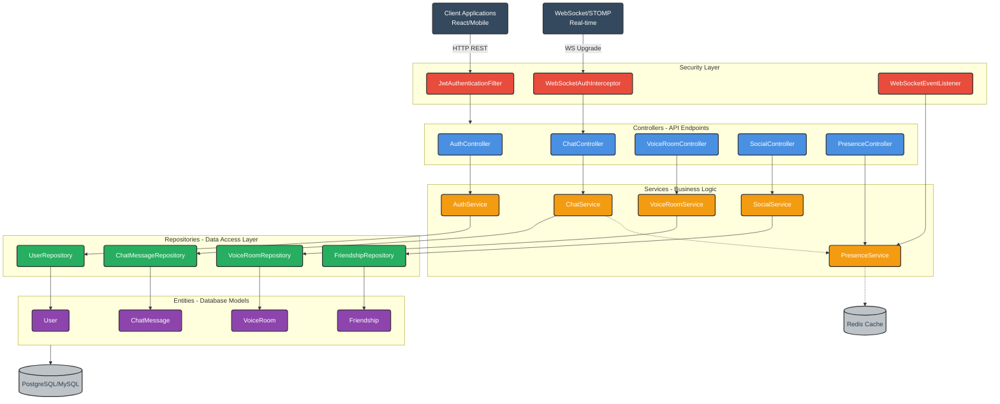
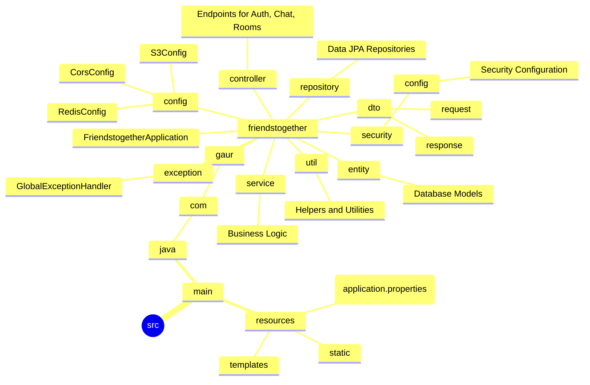

# Project Structure & Architecture

This document provides a visualization of the `friendstogether` backend architecture, detailing the file structure and the logical flow between the various modules in the application.

## High-Level Architecture Flow

The following Mermaid diagram illustrates how data flows through the application, from client requests down to the database level.

## Directory Structure

Here is the structural mapping of the `src` directory visually represented as a mind map:

