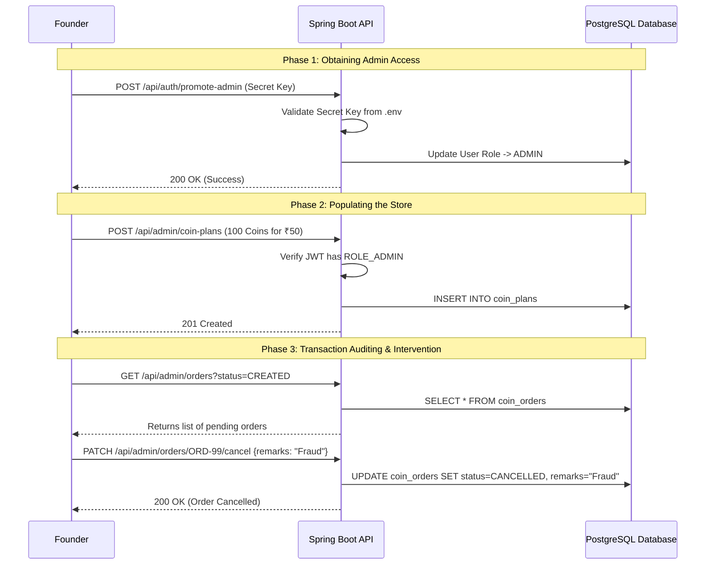

# Admin Panel & Dashboard (FriendsTogether)

This document provides a detailed breakdown of the **Admin Panel Module**. It covers how Admin rights are granted, how monetization plans are managed, and how transactions are monitored and audited securely.

---

## 1. How to Become an Admin (`AdminSetupController`)

For security, there is no generic "register as admin" page on the frontend. Admin privileges are strictly controlled via a backend secret key defined in the server's `.env` or `application.properties` file (`app.admin.secret-key`).

### 1.1 The Promote API
**Endpoint:** `POST /api/auth/promote-admin`
- **Purpose:** Upgrades a standard user to the `ROLE_ADMIN`.
- **Input (JSON):**
  ```json
  {
      "email": "owner@friendstogether.com",
      "secretKey": "FriendsToGether@Admin#2026"
  }
  ```
- **Backend Logic:** The controller checks if the provided `secretKey` exactly matches the environment variable. If it matches, the user's role in the DB is updated to `ADMIN`. The user must log out and log back in to receive a new JWT token containing the `ROLE_ADMIN` claim.

---

## 2. Coin Plan Management (`AdminCoinPlanController`)

Admins have full control over the platform's pricing structure. They can create "Coin Packages" which instantly appear on the user's frontend store.

### 2.1 Supported Endpoints
- **Create Plan (`POST /api/admin/coin-plans`)**: Allows the admin to define `coins`, `bonusCoins`, `priceInr`, and `badge` (e.g., POPULAR, BEST SELLER).
- **Update Plan (`PUT /api/admin/coin-plans/{id}`)**: Modify prices or coin amounts.
- **Toggle Visibility (`PATCH /api/admin/coin-plans/{id}/status`)**: Switch a plan between `ACTIVE` and `INACTIVE`.

### 2.2 The "Soft Delete" Philosophy
- **Endpoint:** `DELETE /api/admin/coin-plans/{id}`
- **Logic:** Financial platforms **never** physically delete pricing data. If an admin deletes a plan, the backend actually performs a **"Soft Delete"** (it just sets the status to `INACTIVE`). 
- **Why?** If User A bought "Plan X" in 2025, their receipt in the database points to Plan X. If we physically drop Plan X from the SQL table, the receipt breaks (Foreign Key Violation).

---

## 3. Transaction Monitoring (`AdminCoinOrderController`)

This controller allows admins to view every single financial transaction across the platform.

### 3.1 Fetching Orders
- **Global Ledger (`GET /api/admin/orders?page=0&size=50`)**: Returns a paginated list of all orders.
- **User Specific (`GET /api/admin/orders/user/{userId}`)**: If a user complains about a missing payment, the admin can pull up all their specific orders.
- **Status Specific (`GET /api/admin/orders/status/PAYMENT_FAILED`)**: Admins can filter to see all failed transactions to investigate gateway issues.

### 3.2 Modifying Orders (Strict Auditing Rules)
Notice that there is **NO HTTP DELETE endpoint** for orders. Financial records are immutable. Instead, Admins can only change the state of an order using `PATCH` endpoints.

- **Cancel Order (`PATCH /api/admin/orders/{orderNumber}/cancel`)**: Used if a user requests a refund or cancellation before the gateway captures it.
- **Expire Order (`PATCH /api/admin/orders/{orderNumber}/expire`)**: Used to clean up stale orders that have been sitting in `CREATED` status for days.
- **Mark Failed (`PATCH /api/admin/orders/{orderNumber}/fail`)**: Manually overriding a stuck order.

**Input Payload for modifications:**
```json
{
  "remarks": "Admin manually cancelled this order due to suspected fraud."
}
```
*The `remarks` field ensures every admin action leaves an audit trail.*

---

## 4. Platform Analytics

While there is no dedicated `AnalyticsController`, the Dashboard UI achieves the high-level analytical overview by aggregating data fetched from the `AdminCoinOrderController` and `UserRepository`.
- Total Revenue = SUM of all orders where status is `PAYMENT_SUCCESS`.
- Total Active Users = Total count of non-suspended users.

---

## 5. End-to-End Visual Flow (Admin Operations)

This diagram shows how the Founder creates an Admin account, logs in, creates a coin plan, and then investigates/cancels a suspicious transaction.


