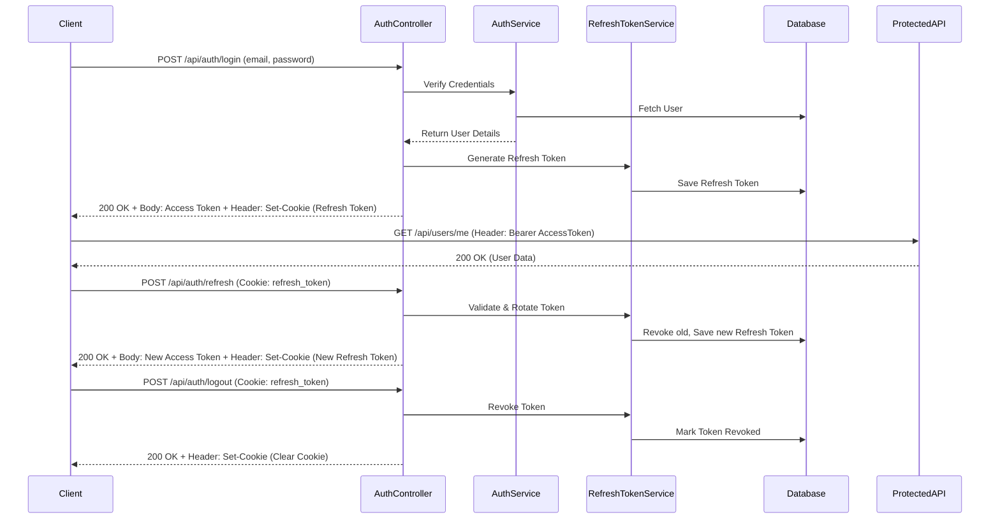

# Authentication & Security Module (FriendsTogether)

This document provides an in-depth analysis of the Authentication and Security architecture of the `FriendsTogether` backend. It covers the code flow, API endpoints, expected request/response schemas, and a Mermaid diagram illustrating the authentication lifecycle.

---

## 1. Architecture & Code Flow

The backend employs a **Stateless JWT (JSON Web Token)** architecture combined with a robust **Refresh Token rotation** strategy via HttpOnly cookies for maximum security against XSS attacks.

### Key Components:
- **`SecurityConfig.java`**: Configures Spring Security. Disables CSRF (since it's a stateless API relying on Bearer tokens), enables CORS, and defines which endpoints are public (e.g., `/api/auth/**`, `/ws/**`, `/actuator/**`) versus protected.
- **`JwtAuthFilter.java`**: Intercepts every incoming request to check for a valid `Bearer` token in the `Authorization` header. If valid, it authenticates the user in the `SecurityContext`.
- **`AuthService.java` & `OAuthAuthenticationService.java`**: Handle the core business logic of verifying credentials, validating OTPs, and exchanging Google OAuth codes.
- **`RefreshTokenService.java`**: Manages the persistence, validation, and rotation of Refresh Tokens in the database, tracking the user's `User-Agent` and IP address.
- **`CookieUtil.java`**: Secures the refresh token by packing it into an `HttpOnly`, `Secure`, `SameSite=Lax` cookie, ensuring JavaScript cannot access it.

### Step-by-Step Internal Backend Flow:
1. **Incoming Request (Client to Server):** A request hits the Spring Boot backend.
2. **Security Filter Chain (`SecurityConfig.java`):** Spring Security intercepts the request. It checks if the endpoint is public (e.g. `/api/auth/login`). If it is, the request bypasses token verification and goes directly to the Controller.
3. **JWT Authentication Filter (`JwtAuthFilter.java`):** If the endpoint is protected (e.g. `/api/users/me`), this filter executes first.
   - It extracts the `Authorization` header and looks for a token starting with `Bearer `.
   - It passes the token to `JwtUtil.java` to verify the signature and expiration.
   - If valid, it extracts the username (email) and loads the user's roles/authorities.
   - It sets an `UsernamePasswordAuthenticationToken` in the `SecurityContextHolder`, marking the user as authenticated for this thread.
4. **Controller Layer (`AuthController.java` / etc.):** The validated request reaches the controller. The controller extracts the DTO (Data Transfer Object) and passes it to the Service layer.
5. **Service Layer (`AuthService.java`):** Business logic executes here. For a login, it checks the database for the user, verifies the password using `BCryptPasswordEncoder`, and generates a new pair of JWT Access and Refresh tokens.
6. **Response Generation:** The Controller receives the tokens. It puts the Access Token inside the JSON response body and uses `CookieUtil` to attach the Refresh Token to the `Set-Cookie` HTTP header.
7. **Client:** The client receives the response, stores the Access Token in memory, while the browser automatically manages and secures the Refresh Token cookie.

---

## 2. Authentication Lifecycle Diagram



---

## 3. API Endpoints Reference

### 3.1. Register User
Registers a new user. The user's account remains unverified until OTP is verified.
- **Endpoint:** `POST /api/auth/register`
- **Request Body:**
  ```json
  {
    "email": "user@example.com",
    "password": "SecurePassword123",
    "name": "John Doe"
  }
  ```
- **Expected Response (200 OK):**
  ```text
  "OTP sent successfully to user@example.com"
  ```

### 3.2. Verify OTP
Verifies the OTP sent to the user's email to activate the account.
- **Endpoint:** `POST /api/auth/verify-otp`
- **Request Body:**
  ```json
  {
    "email": "user@example.com",
    "otp": "123456"
  }
  ```
- **Expected Response (200 OK):**
  ```text
  "Account verified successfully."
  ```

### 3.3. Login (Email/Password)
Authenticates a user and issues tokens. The Access Token is returned in the response body, while the Refresh Token is set as an `HttpOnly` cookie.
- **Endpoint:** `POST /api/auth/login`
- **Request Body:**
  ```json
  {
    "email": "user@example.com",
    "password": "SecurePassword123"
  }
  ```
- **Expected Response (200 OK):**
  **Headers:**
  `Set-Cookie: refresh_token=xxxxx; HttpOnly; Secure; Path=/; Max-Age=604800; SameSite=Lax`
  **Body:**
  ```json
  {
    "accessToken": "eyJhbGciOiJIUz...",
    "tokenType": "Bearer",
    "username": "user@example.com",
    "expiresIn": 900
  }
  ```

### 3.4. Google OAuth2 Exchange
Exchanges a Google OAuth authorization code for backend tokens.
- **Endpoint:** `POST /api/auth/oauth/exchange`
- **Request Body:**
  ```json
  {
    "code": "4/0AX4XfWh..."
  }
  ```
- **Expected Response (200 OK):**
  *(Same as Login response - Access Token in body, Refresh Token in HttpOnly cookie)*

### 3.5. Refresh Token
Exchanges a valid Refresh Token (read automatically from the cookie) for a new Access Token. The Refresh Token is rotated (the old one is revoked, and a new one is issued).
- **Endpoint:** `POST /api/auth/refresh`
- **Request Headers:** 
  `Cookie: refresh_token=xxxxx` *(Sent automatically by browser)*
- **Expected Response (200 OK):**
  **Headers:**
  `Set-Cookie: refresh_token=yyyyy; HttpOnly; Secure; Path=/; Max-Age=604800; SameSite=Lax`
  **Body:**
  ```json
  {
    "accessToken": "eyJhbGciOiJIUz...new",
    "tokenType": "Bearer",
    "username": "user@example.com",
    "expiresIn": 900
  }
  ```

### 3.6. Logout
Revokes the current Refresh Token in the database and clears the browser's cookie.
- **Endpoint:** `POST /api/auth/logout`
- **Request Headers:** 
  `Cookie: refresh_token=xxxxx` *(Sent automatically by browser)*
- **Expected Response (200 OK):**
  **Headers:**
  `Set-Cookie: refresh_token=; HttpOnly; Secure; Path=/; Max-Age=0; SameSite=Lax`
  **Body:**
  ```json
  {
    "message": "Logged out successfully."
  }
  ```

### 3.7. Promote to Admin
A specialized endpoint to grant `ADMIN` privileges to an existing user. It requires a master secret key configured in the backend environment.
- **Endpoint:** `POST /api/auth/promote-admin`
- **Request Body:**
  ```json
  {
    "email": "user@example.com",
    "secretKey": "FriendsToGether@Admin#2026"
  }
  ```
- **Expected Response (200 OK):**
  ```json
  {
    "success": true,
    "message": "User promoted to ADMIN successfully. Please login again to get new token."
  }
  ```
