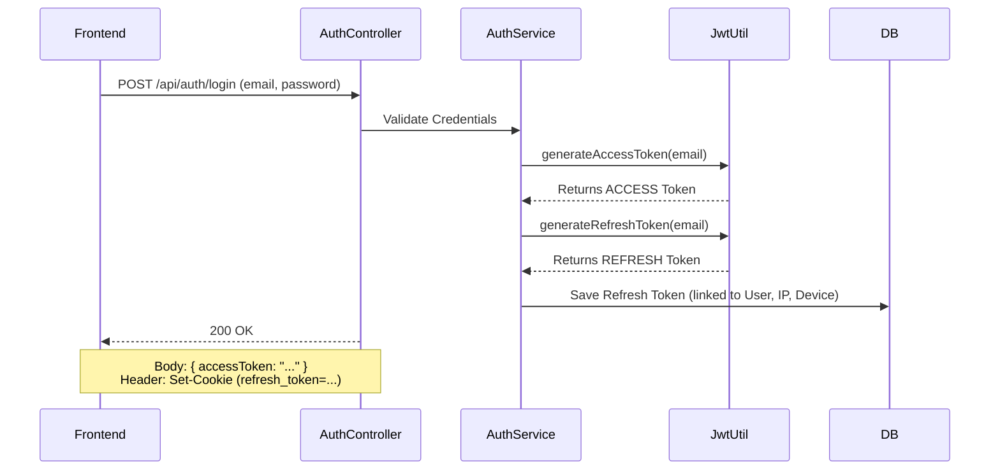
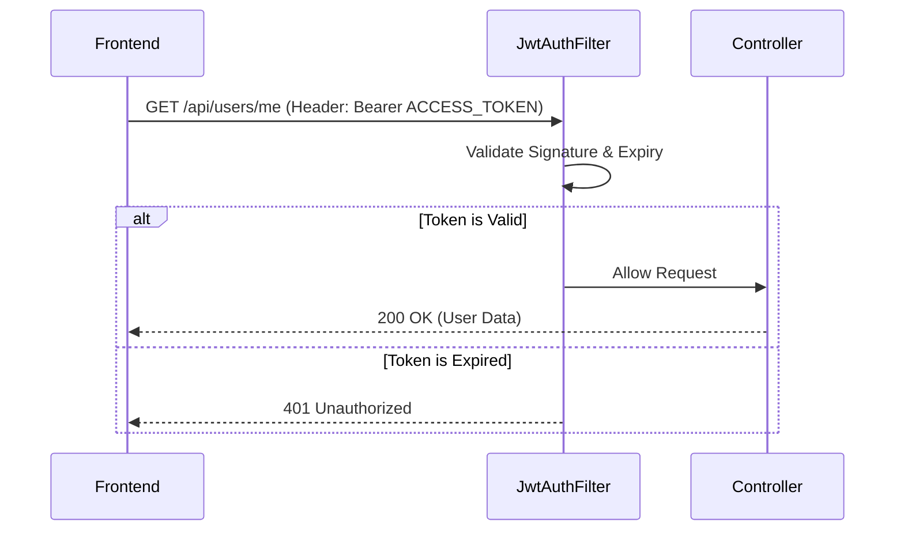
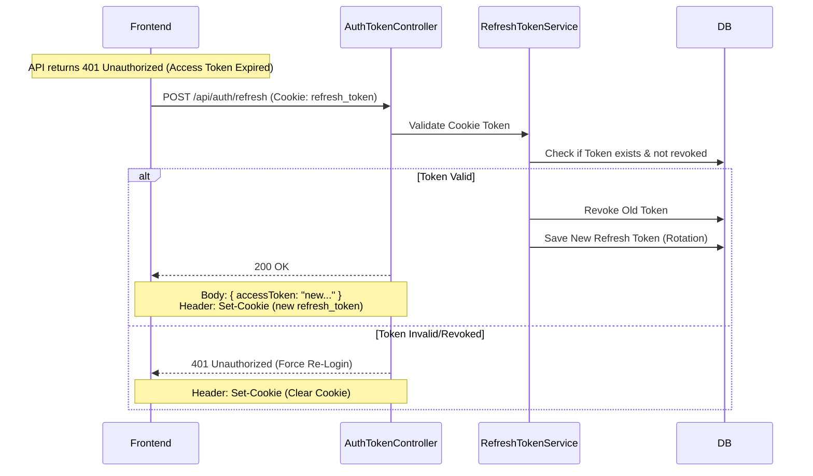

# JWT Token Flow & APIs (FriendsTogether)

This document provides a comprehensive guide to the **Dual-Token JWT Architecture** (Access Token + Refresh Token) used in the FriendsTogether backend. It details how tokens are generated, exchanged, expired, and refreshed securely.

---

## 1. Dual-Token Architecture Overview

The backend uses a stateless authentication mechanism but adds stateful security via Refresh Tokens stored in the database.

1. **Access Token (Short-Lived):** 
   - **Lifespan:** Typically 15 Minutes.
   - **Storage:** In-memory on the Frontend (React State / variable).
   - **Usage:** Sent in the `Authorization: Bearer <token>` header for every API request.
   - **Validation:** Stateless. Verified locally by `JwtUtil` using the secret key (no DB call).

2. **Refresh Token (Long-Lived):**
   - **Lifespan:** Typically 7 Days.
   - **Storage:** Stored securely in an `HttpOnly`, `Secure`, `SameSite=Lax` Cookie. Inaccessible to JavaScript.
   - **Usage:** Sent automatically by the browser to the `/api/auth/refresh` endpoint to get a new Access Token.
   - **Validation:** Stateful. Checked against the `refresh_tokens` database table. If compromised or logged out, it can be instantly revoked.

---

## 2. JWT Flow Diagrams

### 2.1. Initial Generation Flow (Login)



### 2.2. Standard API Request Flow



### 2.3. Token Expiration & Refresh Flow



---

## 3. JWT Utility Methods (`JwtUtil.java`)

The JWT utility distinguishes between token types using a custom claim: `"type": "ACCESS"` or `"type": "REFRESH"`. This prevents a malicious user from using a stolen Refresh Token as an Access Token.

- **`generateAccessToken(email)`**: Creates a token with `CLAIM_TYPE = "ACCESS"`.
- **`generateRefreshToken(email)`**: Creates a token with `CLAIM_TYPE = "REFRESH"`.
- **`validateAccessToken(token)`**: Ensures the signature is valid, not expired, AND `type == ACCESS`.
- **`validateRefreshToken(token)`**: Ensures the signature is valid, not expired, AND `type == REFRESH`.

---

## 4. JWT APIs Reference

### 4.1. Generate Tokens (Login)
- **Endpoint:** `POST /api/auth/login`
- **Purpose:** Verifies credentials and generates the initial Access and Refresh tokens.
- **Request:**
  ```json
  {
    "email": "user@example.com",
    "password": "Password123"
  }
  ```
- **Response (200 OK):**
  - **Headers:** `Set-Cookie: refresh_token=eyJhbG...; HttpOnly; Secure; Path=/; Max-Age=604800; SameSite=Lax`
  - **Body:**
    ```json
    {
      "accessToken": "eyJhbG... (15 min expiry)",
      "tokenType": "Bearer",
      "username": "user@example.com",
      "expiresIn": 900
    }
    ```

### 4.2. Token Exchange / Refresh Flow
- **Endpoint:** `POST /api/auth/refresh`
- **Purpose:** Called by the frontend silently in the background when the Access Token expires. It reads the HttpOnly cookie, rotates the token in the DB, and issues new ones.
- **Request:** No body required. The browser automatically attaches the `refresh_token` cookie.
- **Response (200 OK):**
  - **Headers:** `Set-Cookie: refresh_token=new_eyJhbG...; HttpOnly; Secure; Path=/; Max-Age=604800; SameSite=Lax`
  - **Body:**
    ```json
    {
      "accessToken": "new_eyJhbG... (15 min expiry)",
      "tokenType": "Bearer",
      "username": "user@example.com",
      "expiresIn": 900
    }
    ```
- **Error Response (401 Unauthorized):**
  If the refresh token is expired, tampered with, or revoked from the database (e.g., user logged out from another device).
  - **Headers:** `Set-Cookie: refresh_token=; Max-Age=0` (Clears the cookie)
  - **Body:**
    ```json
    {
      "error": "Refresh token was expired. Please make a new signin request"
    }
    ```

### 4.3. Revoke Token (Logout)
- **Endpoint:** `POST /api/auth/logout`
- **Purpose:** Revokes the Refresh Token in the database so it can never be used again, and clears the user's cookie.
- **Request:** No body required. Cookie sent automatically.
- **Response (200 OK):**
  - **Headers:** `Set-Cookie: refresh_token=; Max-Age=0; HttpOnly; Path=/; SameSite=Lax`
  - **Body:**
    ```json
    {
      "message": "Logged out successfully."
    }
    ```
