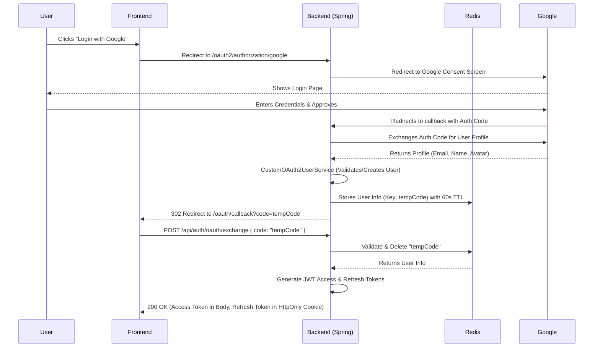

# Google OAuth2 Authentication Module (FriendsTogether)

This document provides a highly detailed, in-depth analysis of the Google OAuth2 implementation in the `FriendsTogether` backend. It explains the end-to-end flow, from the initial Google login prompt to securely exchanging tokens via Redis and HttpOnly cookies.

---

## 1. Architecture & Code Flow

The OAuth2 flow implemented here is a **Hybrid OAuth2 Flow** designed specifically for Decoupled Architectures (where the Frontend (React) and Backend (Spring Boot) run on separate domains). 

Since the frontend and backend are separate, a traditional OAuth2 login (which relies entirely on server-side sessions) won't work securely. Instead, we use a **Temporary Code Exchange via Redis** mechanism.

### Key Components:
- **`CustomOAuth2UserService.java`**: Invoked by Spring Security after Google returns the user's profile. It handles checking if the user exists, rejecting conflicts (e.g., trying to login with Google when a Local Email/Password account already exists), and auto-creating new users.
- **`OAuth2AuthenticationSuccessHandler.java`**: Runs immediately after `CustomOAuth2UserService` succeeds. Instead of generating a JWT directly in the URL (which is insecure), it generates a short-lived, random `tempCode` (UUID), stores the user's info in **Redis** (expiring in 60s), and redirects the user to the frontend with `?code=tempCode`.
- **`OAuthAuthenticationService.java`**: Verifies the `tempCode` sent by the frontend against Redis. If valid, it generates the actual JWT Access and Refresh tokens.
- **`OAuthController.java`**: Exposes the `/exchange` API endpoint for the frontend. Packs the generated Refresh Token into a secure `HttpOnly` cookie.

---

## 2. Step-by-Step Internal Backend Flow

1. **Client Initiation:** 
   - The user clicks "Login with Google" on the frontend.
   - The frontend redirects the user to `https://<backend-url>/oauth2/authorization/google`.
2. **Google Authentication:** 
   - The user logs in on Google's consent screen.
   - Google redirects back to the backend's callback URL with an authorization code.
3. **User Processing (`CustomOAuth2UserService.java`):**
   - Spring Security automatically fetches the user's profile from Google.
   - It checks the database. If a user with the same email exists but registered via standard Email/Password, the login is **rejected** to prevent account hijacking.
   - If the user doesn't exist, it auto-registers the user and assigns a Welcome Bonus (50 coins) via `UserCreationService`.
4. **Temporary Code Generation (`OAuth2AuthenticationSuccessHandler.java`):**
   - The handler generates a unique `tempCode` (UUID).
   - It saves the user's basic info into **Redis** with the key `oauth:code:<tempCode>` and a strict **60-second expiration**.
   - It redirects the browser to the Frontend URL configured in `app.oauth.redirect-uri` (e.g., `https://frontend.com/oauth/callback?code=<tempCode>`).
5. **Token Exchange (`OAuthController.java`):**
   - The frontend extracts the `code` from the URL and sends it to `POST /api/auth/oauth/exchange`.
   - The backend validates the code in Redis. If found, it instantly deletes the Redis key (to prevent replay attacks), generates the final JWT Access Token and Refresh Token, and returns them securely to the frontend.

---

## 3. Google OAuth2 Lifecycle Diagram



---

## 4. API Endpoints Reference

### 4.1. Initiate Google Login (Redirection)
This is not an API you call with AJAX/fetch. The frontend must navigate the browser entirely to this URL.
- **Endpoint:** `GET /oauth2/authorization/google`
- **Expected Behavior:** Redirects the user to Google's standard login page.

### 4.2. Exchange Temporary Code for Tokens
Once the frontend receives the redirect back from the backend containing the `?code=...` query parameter, it must immediately call this endpoint to exchange the code for actual session tokens.
- **Endpoint:** `POST /api/auth/oauth/exchange`
- **Request Body:**
  ```json
  {
    "code": "a1b2c3d4-e5f6-7890-abcd-1234567890ab"
  }
  ```
- **Expected Responses:**

  **Scenario A: Success (200 OK)**
  **Headers Set by Backend:**
  `Set-Cookie: refresh_token=xxxxx; HttpOnly; Secure; Path=/; Max-Age=604800; SameSite=Lax`
  **Body:**
  ```json
  {
    "accessToken": "eyJhbGciOiJIUz...",
    "tokenType": "Bearer",
    "username": "user@gmail.com",
    "expiresIn": 900
  }
  ```

  **Scenario B: Invalid or Expired Code (400 Bad Request)**
  Occurs if the frontend waits more than 60 seconds to make the API call, or if the code was already used (Replay Attack).
  **Body:**
  ```text
  "Error: Invalid or expired authorization code."
  ```

  **Scenario C: Email/Password Collision (Exception Handled during Redirect)**
  If the user tries to login with Google but already has a local account with the same email, the backend rejects it in `CustomOAuth2UserService` and redirects with an error parameter (depending on exact Spring Security failure handler configuration).
