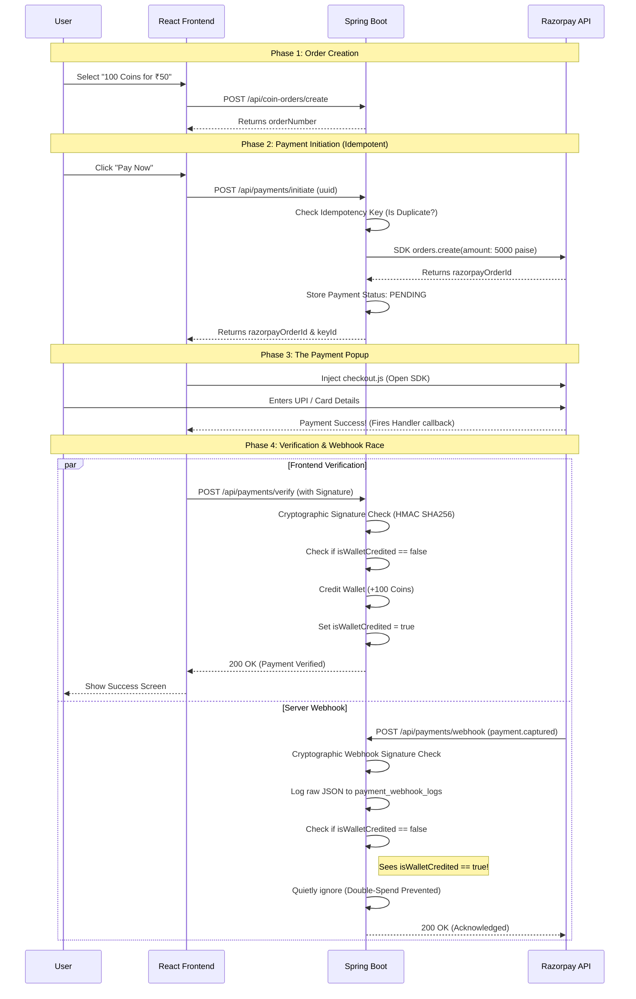

# Payments & Monetization Module (FriendsTogether)

This document provides a deeply technical and exhaustive overview of how users purchase virtual coins using Real Money via **Razorpay**. It covers the exact sequence of APIs, Database Architecture, Idempotency (preventing double clicks), Cryptographic Signature verification, and Webhook double-spend protection.

---

## 1. Database Architecture & Schema

The Payment system utilizes four main SQL tables to maintain 100% data integrity and auditability.

### 1.1 `coin_orders` (The Cart)
- **Fields:** `id`, `user_id`, `order_number`, `plan_code`, `total_coins`, `order_amount`, `status` (CREATED, PAYMENT_PENDING, PAYMENT_SUCCESS, PAYMENT_FAILED).
- **Purpose:** Represents the user's intent to buy. It maps a User to a specific `CoinPlan` (e.g., 100 Coins for ₹50).

### 1.2 `payments` (The Gateway Ledger)
- **Fields:** `id`, `order_id`, `provider` (RAZORPAY), `gateway_order_id`, `gateway_payment_id`, `gateway_signature`, `amount`, `status` (PENDING, CAPTURED, FAILED), `wallet_credited` (BOOLEAN).
- **Purpose:** Tracks the actual connection to Razorpay. It links the internal `coin_order` to the external Razorpay `order_F9k...`.

### 1.3 `idempotency_records` (The Bouncer)
- **Fields:** `idempotency_key`, `payment_id`, `status` (PROCESSING, COMPLETED).
- **Purpose:** Caches the payment request. If a user clicks the "Pay Now" button 5 times rapidly, this table ensures only 1 Razorpay Order is generated.

### 1.4 `payment_webhook_logs` (The Audit Trail)
- **Fields:** `id`, `payment_id`, `gateway_event_id`, `payload` (JSON), `status` (PROCESSED).
- **Purpose:** Every webhook received from Razorpay is logged here verbatim to ensure compliance and debug missing payments.

---

## 2. The Complete End-to-End Payment Flow

The payment architecture involves 3 main actors: **Frontend (React)**, **Backend (Spring Boot)**, and **Razorpay (Payment Gateway)**.

### Step 1: Order Creation (Internal)
1. The user selects a Coin Plan (e.g., 100 Coins for ₹50).
2. The frontend calls `POST /api/coin-orders/create`.
3. The backend creates an internal `CoinOrder` with status `CREATED` and generates a unique `orderNumber`.

### Step 2: Payment Initiation (Razorpay Order)
1. The user clicks "Pay Now".
2. The frontend calls **`POST /api/payments/initiate`** passing the `orderNumber` and an `Idempotency-Key` (e.g., UUID generated by frontend).
3. The backend verifies the Idempotency Key. If it's a duplicate request, it returns the cached `razorpayOrderId`. 
4. If it's new, it uses the **Razorpay SDK** to hit Razorpay's servers (`razorpayClient.orders.create(amount_in_paise)`). Note: Razorpay requires amount in Paise (₹50 = 5000 Paise).
5. Razorpay returns a `gatewayOrderId` (e.g., `order_F9k...`).
6. The backend stores this in the `payments` table with Status `PENDING` and returns it to the frontend.

### Step 3: Frontend Checkout (Razorpay SDK)
1. The React frontend injects `https://checkout.razorpay.com/v1/checkout.js`.
2. It initializes the `Razorpay` object using the `razorpayOrderId`, `amount`, and `keyId`.
3. A popup opens. The user enters their UPI/Card details to pay.
4. Razorpay processes the payment and fires a Javascript `handler` callback containing `razorpay_payment_id`, `razorpay_order_id`, and `razorpay_signature`.

### Step 4: Verification & Webhook (The Race Condition)
Once the payment is successful, Razorpay does **TWO things at the exact same time**:
- **Action A:** Closes the popup on the Frontend. The frontend immediately calls **`POST /api/payments/verify`**.
- **Action B:** Fires a Server-to-Server Webhook event (`payment.captured`) directly to our Backend at **`POST /api/payments/webhook`**.

Whichever request reaches the backend first will verify the cryptographically secure signature, mark the payment as `CAPTURED`, and **Credit the Wallet**. The second request will hit the "Double-Spend Protection" block and quietly exit.

---

## 3. Deep Dive: Cryptography & Signatures

How do we prevent a hacker from just calling `POST /api/payments/verify` with fake data and giving themselves 1,000,000 coins? **HMAC SHA256 Cryptography**.

When Razorpay sends the success payload to the frontend, it includes a `razorpay_signature`. 
Inside `PaymentService.java`, the backend calculates the expected signature:
```java
String payload = request.getRazorpayOrderId() + "|" + request.getRazorpayPaymentId();
boolean isValid = Utils.verifySignature(payload, request.getRazorpaySignature(), razorpaySecret);
```
Because the hacker does not know the internal `razorpaySecret` (stored in `.env`), they cannot generate a valid signature. The backend immediately throws a `400 Bad Request: Tampering Detected`.

---

## 4. API Inputs & Outputs (In Sequence)

### 4.1 Initiate Payment API
**Endpoint:** `POST /api/payments/initiate`
- **Input:**
  ```json
  {
    "orderNumber": "ORD-2026-XYZ123",
    "idempotencyKey": "uuid-v4-1111-2222"
  }
  ```
- **Response (201 Created):**
  ```json
  {
    "success": true,
    "message": "Payment initiated successfully",
    "data": {
      "razorpayOrderId": "order_KgH...",
      "amount": 50,
      "currency": "INR",
      "keyId": "rzp_test_123abc",
      "internalPaymentReference": "PAY-998877"
    }
  }
  ```

### 4.2 Verify Payment API (Frontend Driven)
**Endpoint:** `POST /api/payments/verify`
- **Input:**
  ```json
  {
    "razorpayOrderId": "order_KgH...",
    "razorpayPaymentId": "pay_KxL...",
    "razorpaySignature": "a3b9c8d7e6f5..."
  }
  ```
- **Response (200 OK):**
  ```json
  { "success": true, "message": "Payment verified and coins credited successfully" }
  ```

### 4.3 Webhook API (Server Driven)
**Endpoint:** `POST /api/payments/webhook`
- **Input Headers:** `X-Razorpay-Signature` (A different cryptographic signature protecting the webhook payload).
- **Input Body:** Razorpay JSON payload (`event: "payment.captured"`).
- **Backend Logic (`PaymentService.handleWebhook`):**
  1. Validates `Utils.verifyWebhookSignature`.
  2. Parses the `order_id` and the `payment_method` (UPI, Card, Netbanking).
  3. Checks `payment.isWalletCredited()`. **(Double Spend Protection)**
  4. If false, credits the wallet and sets `isWalletCredited = true`.
  5. Logs the entire raw JSON into `payment_webhook_logs`.

---

## 5. Double-Spend Protection (Crucial Logic)

When real money is involved, race conditions are deadly. If the Frontend `/verify` and the Razorpay `/webhook` hit the backend at the exact same millisecond, the user might get 200 coins instead of 100.

**How we prevent this in `PaymentService.java`:**
```java
// Inside verifyPayment() and handleWebhook()
if (payment.isWalletCredited()) {
    logger.info("Wallet already credited for this payment. Skipping.");
    return;
}
// Followed by Database @Transactional locks.
payment.setWalletCredited(true);
walletService.credit(userId, coins...);
```
Whichever thread reaches the IF statement first, commits `walletCredited = true`. The second thread sees it as `true` and safely ignores the request.

---

## 6. Complete End-to-End Visual Architecture

This diagram shows the complete sequence, the popup interaction, and the race condition between the frontend verification and the webhook.


