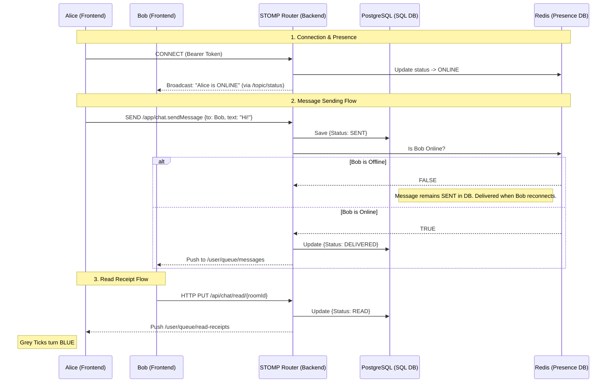

# Real-Time Chat & WebSockets Module (FriendsTogether)

This document is a **Deep-Dive Learning Resource** into how the Real-Time Chat Engine works in the FriendsTogether backend. It covers STOMP over WebSockets, Message Delivery Lifecycles (Online/Offline), Read Receipts, Pagination (Infinite Scroll), and Typing Indicators.

---

## 1. What is STOMP and Why Use It?

WebSockets provide a raw TCP connection, which is great but unstructured. If you send a JSON string, the server has to manually parse it and figure out who to send it to. 

**STOMP (Simple Text Oriented Messaging Protocol)** is an application-level protocol that sits on top of WebSockets. It adds "Routing" (like HTTP routes). Instead of a raw socket, STOMP gives you:
- **Destinations:** Send messages to specific paths (e.g., `/app/chat.sendMessage`).
- **Topics (Pub/Sub):** Many people can listen to one channel (e.g., `/topic/status`).
- **Queues (1-to-1):** Direct messaging to a single user (e.g., `/user/queue/messages`).

### STOMP Configuration in Backend (`WebSocketConfig.java`)
- **Connection Endpoint:** `ws://api.domain.com/ws` (Client connects here first).
- **Application Prefix (`/app`):** If a client sends a message to `/app/chat.sendMessage`, it routes to a Java method annotated with `@MessageMapping("/chat.sendMessage")` in `ChatController.java`.
- **Broker Prefix (`/topic`, `/queue`):** When the backend wants to push data to clients, it sends it through these prefixes.
- **User Prefix (`/user`):** Special prefix used by Spring to resolve individual user sessions dynamically based on their JWT token.

---

## 2. Connection & Presence Lifecycle (Online/Offline Events)

How does the server know someone is Online or Offline without hitting the database on every request? **Spring Events + Redis**.

### Step 1: Connecting to the Socket
1. The Frontend establishes a WebSocket connection to `ws://.../ws`.
2. It sends a STOMP `CONNECT` frame containing the JWT Access Token in the headers.
3. **`WebSocketAuthInterceptor`** intercepts this frame, validates the JWT, and attaches the user's `Principal` (Email) to the WebSocket Session.

### Step 2: The `SessionConnectedEvent` (User comes ONLINE)
When the connection succeeds, Spring fires a `SessionConnectedEvent` inside `WebSocketEventListener.java`.
- **What happens internally?**
  1. The backend updates the user's status to `ONLINE` in Redis (`presenceService.userOnline`).
  2. It broadcasts this to everyone listening to `/topic/status`.
  3. **Crucial Step:** It calls `chatService.deliverPendingMessages(email)`. Any messages sent to this user while they were offline are instantly fetched from SQL (where `status = SENT`) and pushed to their WebSocket.

### Step 3: The `SessionDisconnectEvent` (User goes OFFLINE)
When the user closes the browser or loses internet, Spring fires a `SessionDisconnectEvent`.
- **What happens internally?**
  1. The backend updates the user's status to `OFFLINE` in Redis (`presenceService.userOffline`).
  2. It broadcasts the `OFFLINE` event to `/topic/status`.

---

## 3. Message Delivery Workflow (The Complete Story)

When Alice sends a message to Bob, the journey depends heavily on Bob's real-time state.

### 3.1. The Payload (Input)
Alice's Frontend publishes a STOMP message to `/app/chat.sendMessage`:
```json
{
  "receiverId": "usr_9988",
  "content": "Hello Bob!",
  "type": "TEXT"
}
```

### 3.2. Processing in `ChatService.java`
1. The backend verifies Alice's identity using the WebSocket Session `Principal`.
2. It generates a **Deterministic Room ID** (e.g., `AliceID_BobID`).
3. It creates a `ChatMessage` entity in PostgreSQL with **`Status: SENT`**.

### 3.3. The Cross-Roads (Online vs Offline)
The backend asks Redis: *Is Bob online right now?* (`presenceService.isOnline(bobEmail)`)

**Scenario A: Bob is ONLINE**
1. The backend updates the message in SQL to **`Status: DELIVERED`**.
2. It uses `SimpMessagingTemplate.convertAndSendToUser(bobEmail, "/queue/messages", messageDto)` to push the JSON message directly to Bob's browser.
3. Bob's screen updates instantly.

**Scenario B: Bob is OFFLINE**
1. The backend does nothing further. The message stays in PostgreSQL as **`Status: SENT`**.
2. Hours later, Bob opens his phone. The STOMP socket connects.
3. The `SessionConnectedEvent` fires. The backend finds all messages for Bob where `Status = SENT`.
4. It updates them to `DELIVERED` and pushes them down the socket to Bob.

---

## 4. Message Statuses & Read Receipts

The system tracks three states for a message:
- **`SENT` (Single Tick):** Stored in DB, receiver is offline.
- **`DELIVERED` (Double Tick):** Pushed to the receiver's WebSocket or fetched via history.
- **`READ` (Blue Tick):** The receiver actively opened the chat window.

### How Read Receipts Work:
When Bob opens the chat window with Alice, Bob's frontend automatically calls a REST API:
- **Endpoint:** `PUT /api/chat/read/{roomId}`
- **Backend Action (`ChatService.markMessagesAsRead`):**
  1. Updates all messages in that `roomId` where receiver is Bob and status is `DELIVERED` (or `SENT`) to **`READ`**.
  2. The backend then fires a WebSocket STOMP message **back to Alice**.
  3. It sends a `ReadReceiptEvent` to Alice's `/user/queue/read-receipts` channel.
  4. Alice's frontend receives this and turns her grey double ticks into blue double ticks.

---

## 5. Chat History & Infinite Scroll (Pagination)

WebSockets are only for *live* data. If a user refreshes the page, they need the old messages. This is done via a standard HTTP REST API using Spring Data JPA `Pageable`.

### Infinite Scroll API
- **Endpoint:** `GET /api/chat/history/{friendUserId}?page=0&size=10`
- **Frontend Action (`useChat.js`):** 
  When the user scrolls to the top of the chat window, the frontend increments the `page` variable and calls this API again (e.g., `page=1`, `page=2`).
- **Backend Action (`ChatService.getChatHistory`):**
  1. Generates the `roomId`.
  2. Runs a SQL Query: `SELECT * FROM chat_message WHERE room_id = ? ORDER BY timestamp DESC LIMIT 10 OFFSET 0`.
  3. Notice it fetches `DESC` (Newest first). The backend then runs `Collections.reverse(list)` so they appear in chronological order (Top to Bottom) for the UI.
  4. Also filters out messages the user has deleted for themselves (`deletedForSender = true`).

---

## 6. Typing Indicators (Story & Workflow)

Typing indicators ("User is typing...") are extremely transient. They should **never** be saved to the database. They exist purely on the WebSocket layer.

### How it works (Standard STOMP Implementation):
1. **Frontend trigger:** Alice types a letter. The frontend sets a timeout of 2 seconds.
2. **Publish:** Alice's frontend sends a tiny STOMP frame to `/app/chat.typing`:
   ```json
   { "receiverId": "usr_9988", "isTyping": true }
   ```
3. **Backend Routing:** The `ChatController` intercepts this. It does NOT touch the database. It immediately routes it to Bob's inbox:
   ```java
   messagingTemplate.convertAndSendToUser(bobEmail, "/queue/typing", typingEvent);
   ```
4. **Bob's Screen:** Bob's frontend receives the event and shows the bubble.
5. **Stop Typing:** If Alice stops typing for 2 seconds (debounce), her frontend sends `{ "isTyping": false }`, and Bob's UI hides the bubble.

---

## 7. Complete WebSocket Channel Reference

If you are building the frontend socket client, you must handle these endpoints:

| Action | STOMP Channel | Direction | Description |
|---|---|---|---|
| **Send Message** | `/app/chat.sendMessage` | Send (Frontend -> Server) | Sends a new chat message to a user. |
| **Receive Message** | `/user/queue/messages` | Listen (Server -> Frontend) | Receives incoming messages AND echoes of your own sent messages. |
| **Read Receipts** | `/user/queue/read-receipts` | Listen (Server -> Frontend) | Tells you if your friend read your message (Turns ticks blue). |
| **Delete Events** | `/user/queue/delete-events` | Listen (Server -> Frontend) | Tells you if a message was deleted for everyone. |
| **Global Status** | `/topic/status` | Listen (Server -> Frontend) | Broadcasts when ANY user comes online or goes offline. |

---

## 8. Backend Architecture Diagram (The Full Picture)


