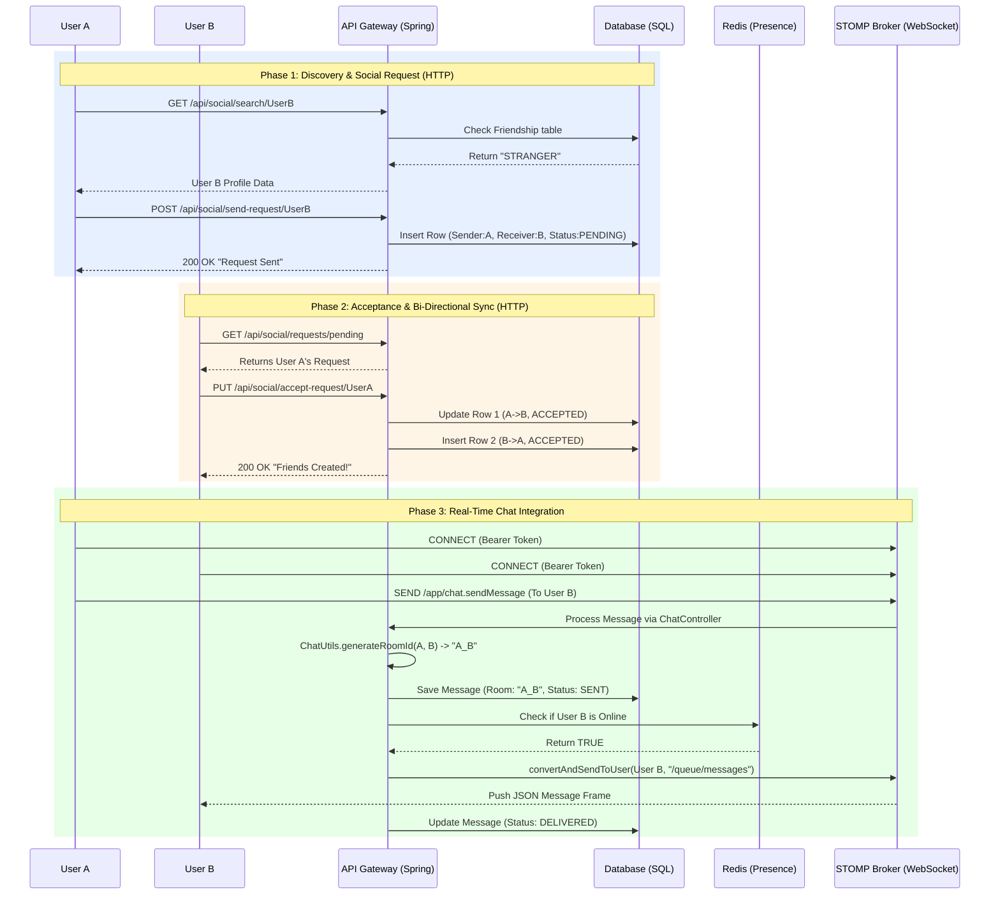

# Social & Networking Module (FriendsTogether)

This document provides a highly detailed, comprehensive overview of the **Friends System**, **Friend List Management**, their relationship with **WebSockets (Chat)**, and the **Blocking Mechanism** in the FriendsTogether backend.

---

## 1. Database Schema & Bi-Directional Logic

The backend uses a **Bi-directional Friendship Model** managed by `SocialService.java` and persisted in the `friendships` SQL table.

### Schema Structure (`Friendship` Entity)
- `id` (Primary Key)
- `sender_id` (Foreign Key -> `users.id`)
- `receiver_id` (Foreign Key -> `users.id`)
- `status` (Enum: `PENDING`, `ACCEPTED`)

### State Transitions (How Data is Stored)

**Scenario:** User A (Alice) wants to be friends with User B (Bob).

**State 1: Initial Send Request (`PENDING`)**
When Alice calls `/send-request`:
| ID | Sender | Receiver | Status |
|---|---|---|---|
| 1 | Alice | Bob | PENDING |

**State 2: Bob Accepts Request (`ACCEPTED`)**
When Bob calls `/accept-request`, the system runs a `@Transactional` block that modifies the existing row AND generates a **reverse row** to ensure hyper-fast read queries:
| ID | Sender | Receiver | Status |
|---|---|---|---|
| 1 | Alice | Bob | ACCEPTED |
| 2 | Bob | Alice | ACCEPTED |

*(Because of this reverse row, when Alice or Bob fetch their friends list, the SQL query is a simple `SELECT * FROM friendships WHERE sender_id = ME AND status = 'ACCEPTED'`. No complex `OR` clauses are needed!)*

---

## 2. API Reference (Exact JSON Schemas & Workflows)

All APIs are secured via Spring Security and require the `Authorization: Bearer <AccessToken>` header. The DTO used for returning users is `SocialUserResponse`.

### 2.1. Search User (`GET /api/social/search/{userId}`)
- **Internal Workflow:** 
  1. Finds the Target User.
  2. Counts the Target User's total friends (`countAcceptedFriends`).
  3. Checks the `friendships` table in *both* directions to resolve the relationship string (`STRANGER`, `PENDING_SENT`, `PENDING_RECEIVED`, `FRIENDS`, `SELF`).
- **Expected Response (200 OK):**
  ```json
  {
    "userId": "usr_9988",
    "nickname": "ProGamer",
    "avatarUrl": "https://s3.amazonaws.com/bucket/profile.jpg",
    "level": 5,
    "status": "STRANGER",
    "friendsCount": 12,
    "email": "progamer@example.com"
  }
  ```

### 2.2. Send Friend Request (`POST /api/social/send-request/{userId}`)
- **Internal Workflow:** Validates you aren't sending a request to yourself, checks if a request already exists, and inserts the `PENDING` row.
- **Expected Response (200 OK):** `"Friend request sent successfully!"`
- **Error Response (400 Bad Request):** `"Error: A friend request or friendship already exists between you two."`

### 2.3. Get Pending Requests (Inbox) (`GET /api/social/requests/pending`)
- **Internal Workflow:** Queries `friendships` table where `receiver = currentUser` AND `status = PENDING`.
- **Expected Response (200 OK):**
  ```json
  [
    {
      "userId": "usr_1111",
      "nickname": "Alice",
      "avatarUrl": "https://s3...",
      "level": 2,
      "status": "PENDING_RECEIVED",
      "friendsCount": 0,
      "email": "alice@example.com"
    }
  ]
  ```

### 2.4. Accept Request (`PUT /api/social/accept-request/{senderUserId}`)
- **Internal Workflow:** 
  1. Finds the `PENDING` row where `sender = senderUserId` and `receiver = currentUser`.
  2. Updates status to `ACCEPTED`.
  3. In the same transaction, creates the reverse `ACCEPTED` row.
- **Expected Response (200 OK):** `"Success: You and Alice are now friends!"`

### 2.5. Reject Incoming Request (`DELETE /api/social/reject-request/{senderUserId}`)
- **Internal Workflow:** Finds the `PENDING` row and **Hard Deletes** it from the SQL database using `friendshipRepository.delete()`.
- **Expected Response (200 OK):** `"Friend request rejected."`

### 2.6. Fetch Friends List (`GET /api/social/friends`)
- **Internal Workflow:** Queries `findAllAcceptedFriends(currentUser)`. Loops through the result set and maps the opposite party to `SocialUserResponse`.
- **Expected Response (200 OK):**
  ```json
  [
    {
      "userId": "usr_1111",
      "nickname": "Alice",
      "avatarUrl": "https://s3...",
      "level": 2,
      "status": "FRIENDS",
      "email": "alice@example.com"
    }
  ]
  ```

### 2.7. Unfriend (`DELETE /api/social/unfriend/{friendUserId}`)
- **Internal Workflow:** Finds **both** `ACCEPTED` rows (A->B and B->A) and hard deletes them from the database.
- **Expected Response (200 OK):** `"Unfriended successfully."`

---

## 3. Blocking Mechanism (Current vs Future Implementation)

### Soft Block (Currently Implemented via Unfriend)
If you do not want to talk to someone, you use the `/unfriend/{userId}` endpoint. 
- **What it does:** Completely deletes the bidirectional rows from the `Friendship` SQL table.
- **Chat Impact:** Since the connection is severed, the user is immediately removed from your Chat List and Friends List.
- **Limitation:** Because the row is deleted, the other user *can* theoretically send you a new friend request again if they know your UserID.

### Hard Block (Future Extension)
For a strict blocking mechanism (where they cannot even search you or send requests), a dedicated `blocked_users` table (`blocker_id`, `blocked_id`) will be implemented. The `SocialService` will intercept the `/send-request` API and throw a `403 Forbidden` if a block record exists.

---

## 4. Deep Relationship with WebSockets (Chat Connection)

The Social Module and the WebSockets (`ChatController`) work hand-in-hand. The connection between the two systems relies on a **Deterministic Room Generation Logic**.

### 1. Deterministic Room Logic (`ChatUtils.java`)
When two friends open a chat, the backend generates a unique Room ID based on their UserIDs. 
```java
// Example pseudo-code of ChatUtils.generateRoomId(String id1, String id2)
String roomId = id1.compareTo(id2) < 0 ? id1 + "_" + id2 : id2 + "_" + id1;
```
Because the IDs are sorted alphabetically before concatenating, `generateRoomId("Alice", "Bob")` and `generateRoomId("Bob", "Alice")` will ALWAYS output `"Alice_Bob"`. This guarantees both friends join the exact same WebSocket room.

### 2. STOMP Routing & Security
- **Subscription:** Users subscribe to their private inbox: `/user/queue/messages`.
- **Sending:** User A sends a STOMP payload to `/app/chat.sendMessage` with User B's ID.
- **Service Layer (`ChatService`):**
  - Generates the Room ID using `ChatUtils`.
  - Saves the message in PostgreSQL (`status: SENT`).
  - Checks **Redis** (`PresenceService`) to see if User B is online.
  - If Online: Routes the payload via `SimpMessagingTemplate.convertAndSendToUser("UserB_Email", "/queue/messages", messageDto)` and updates the DB to `DELIVERED`.

---

## 5. Complete Architecture Visualization


