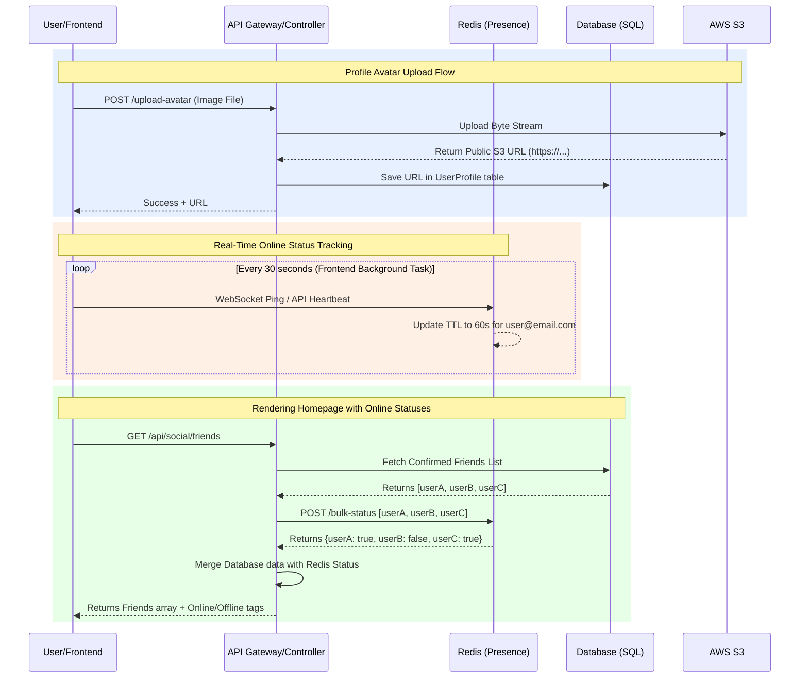

# User Management & Discovery (FriendsTogether)

This document covers the **User Management**, **Social Networking**, **AWS S3 Avatar Management**, and **Real-Time Redis Presence Tracking** features of the FriendsTogether backend in extreme technical detail.

---

## 1. Profile Management & AWS S3 Flow

User profiles are managed via the `UserController`. The standout feature is the direct integration with AWS S3 for storing user avatars securely. This keeps the application servers lightweight as they do not store static images.

### Code Flow (Avatar Upload to S3)
1. **Client Request:** Frontend sends a `multipart/form-data` request with the image file to `/api/users/upload-avatar`.
2. **Controller Layer:** `UserController` receives the `MultipartFile` and passes it to `FileService` (or `S3Service`).
3. **AWS S3 Upload:** The service generates a unique UUID filename (e.g., `profile-5f4dcc3b5aa765d61d8327deb882cf99.jpg`), uploads the file byte stream to the configured AWS S3 bucket, and retrieves the public object URL.
4. **Database Update:** The S3 URL is passed to `UserService.updateAvatar(email, url)`, which saves the URL in the `UserProfile` entity.
5. **Response:** The API returns the success message and the new S3 URL so the frontend can update the UI instantly without reloading.

### Profile API Details

#### 1. Fetch Profile (`GET /api/users/me`)
- **Headers:** `Authorization: Bearer <AccessToken>`
- **Expected Response (200 OK):**
  ```json
  {
    "userId": "usr_7x8y9z",
    "email": "user@example.com",
    "nickname": "John Doe",
    "bio": "Avid gamer and coder.",
    "avatarUrl": "https://friendstogether-bucket.s3.amazonaws.com/profile-5f4d.jpg",
    "level": 5
  }
  ```

#### 2. Update Profile (`PUT /api/users/update-profile`)
- **Request Body:**
  ```json
  {
    "nickname": "John Doe Updated",
    "bio": "Loving the new update!"
  }
  ```
- **Expected Response (200 OK):** `"Profile updated successfully"`

#### 3. Upload Avatar (`POST /api/users/upload-avatar`)
- **Content-Type:** `multipart/form-data`
- **Body:** `file` (Binary Image Data)
- **Expected Response (200 OK):** `"Success! Image saved to DB. URL: https://s3..."`

---

## 2. Real-Time Presence (Redis Online/Offline)

To show who is online on the homepage without overloading the primary PostgreSQL/MySQL database, we use **Redis** as a fast, in-memory presence tracker.

### How it Works (Heartbeat Mechanism)
- When a user logs in or connects to the WebSocket, a "Heartbeat" is sent to Redis, setting a key `presence:user@example.com` with an expiration (TTL) of exactly **60 seconds**.
- As long as the user stays active on the website, the frontend sends a periodic heartbeat (ping) every **30 seconds** to refresh the TTL back to 60s.
- If the user closes the app, loses internet, or logs out, the heartbeat stops. Redis automatically deletes the key after 60 seconds (TTL expiry), and the user is naturally marked as "Offline".

### Presence API Details

#### 1. Bulk Status Check (`POST /api/chat/presence/bulk-status`)
*(Highly optimized for rendering friends lists or homepage user grids)*
- **Request Body (Set of Emails):**
  ```json
  [
    "alice@example.com",
    "bob@example.com",
    "charlie@example.com"
  ]
  ```
- **Expected Response (200 OK):**
  ```json
  {
    "alice@example.com": true,
    "bob@example.com": false,
    "charlie@example.com": true
  }
  ```

#### 2. Get Global Online Count (`GET /api/chat/presence/online-count`)
- **Expected Response:** `142` *(Integer representing total active connections)*

---

## 3. Social & Networking Flow (Friends System)

The `SocialController` handles the entire friend lifecycle using bi-directional relations in the database.

### Friend Lifecycle Flow
1. **Search:** User A calls `/api/social/search/{userId}` to find User B.
2. **Send Request:** User A calls `/api/social/send-request/{userId}`. The system verifies they aren't already friends, then creates a pending connection record.
3. **Inbox Check:** User B calls `/api/social/requests/pending` and sees User A's request.
4. **Accept/Reject:** User B calls `/accept-request` (creating the confirmed two-way friendship) or `/reject-request` (deleting the pending record).

### Social API Details

#### 1. Search User (`GET /api/social/search/{userId}`)
- **Expected Response (200 OK):**
  ```json
  {
    "userId": "usr_9988",
    "nickname": "ProGamer",
    "avatarUrl": "https://s3...",
    "friendshipStatus": "NOT_FRIENDS" // Can be FRIENDS, PENDING_SENT, PENDING_RECEIVED
  }
  ```

#### 2. Fetch Friends List (`GET /api/social/friends`)
- **Expected Response (200 OK):**
  ```json
  [
    {
      "userId": "usr_1234",
      "nickname": "Alice",
      "avatarUrl": "https://s3..."
    },
    {
      "userId": "usr_5678",
      "nickname": "Bob",
      "avatarUrl": "https://s3..."
    }
  ]
  ```

---

## 4. Discovery & Homepage

The Discovery module (`DiscoveryController.java`) powers the homepage by fetching active Voice Rooms or suggested users.

### Code Flow & Security
- **Pagination (`Pageable`):** Ensures the homepage loads instantly. Instead of fetching 1000 rooms, it fetches chunks (e.g., 20 at a time).
- **Server Protection:** A strict limit is enforced (`Math.min(pageable.getPageSize(), 50)`). Even if a hacker attempts to request `size=10000` via Postman, the backend forces it down to 50 to prevent out-of-memory (OOM) crashes.
- **Unified Response Wrapper:** Uses `ApiResponse<T>` to standardize all JSON outputs.

### Discovery API Details

#### 1. Fetch Paginated Rooms (`GET /api/v1/discovery?page=0&size=20`)
- **Expected Response (200 OK):**
  ```json
  {
    "success": true,
    "message": "Discovery rooms fetched successfully",
    "data": {
      "content": [
        {
          "roomId": "room_abc123",
          "title": "Late Night Music",
          "category": "MUSIC",
          "hostName": "DJ Khaled",
          "participantCount": 14,
          "maxCapacity": 50
        }
      ],
      "pageable": {
        "pageNumber": 0,
        "pageSize": 20
      },
      "totalElements": 1,
      "totalPages": 1,
      "last": true
    },
    "timestamp": "2026-08-30T10:00:00.000Z"
  }
  ```

---

## 5. Architecture Diagram (Homepage & Presence Integration)


