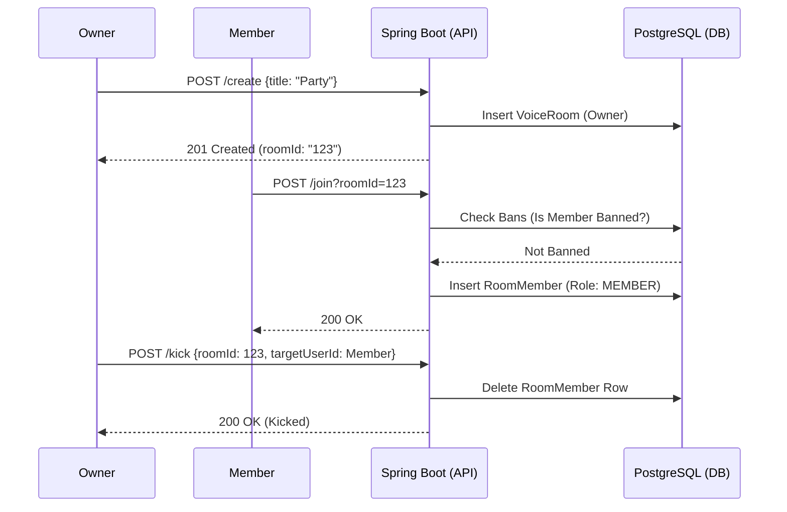
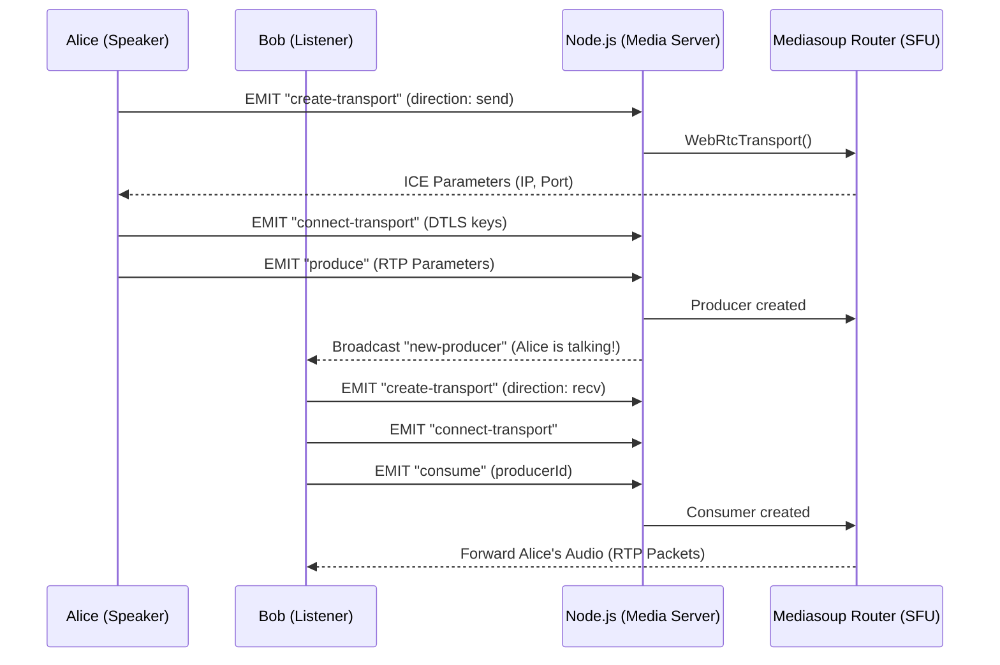
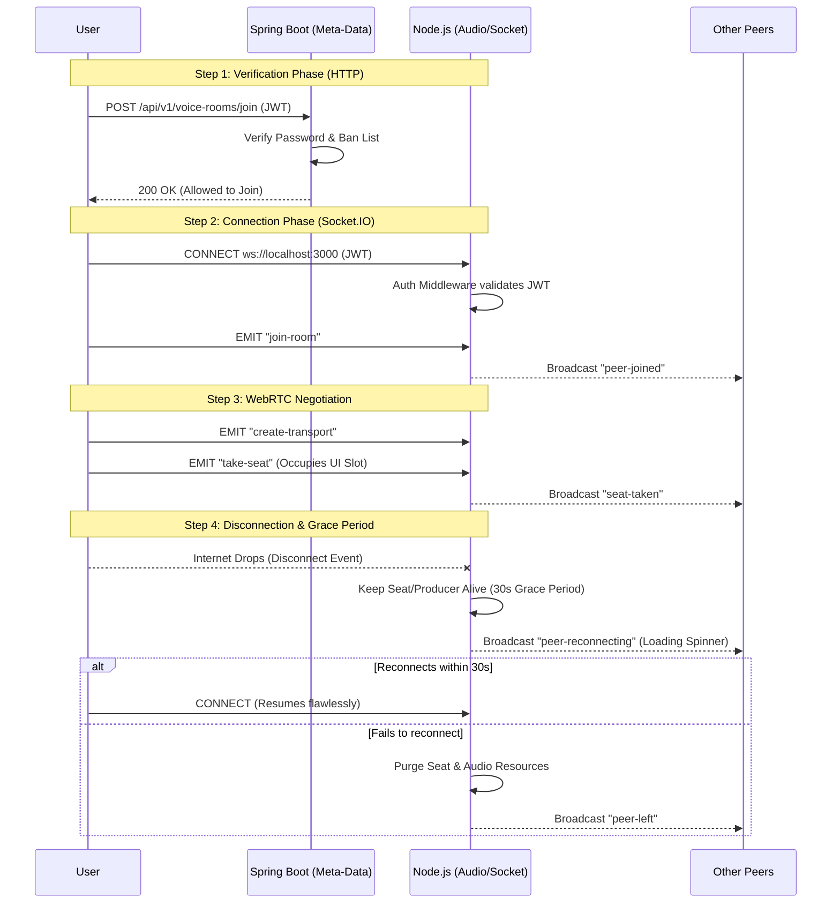

# Voice Rooms & WebRTC Signaling (FriendsTogether)

This document is the **Ultimate Deep-Dive Guide** into the Voice Rooms module. It includes the exact **Input/Output schemas** for all APIs, and **3 In-Depth Visualizations** covering the dual-backend architecture.

---

## 1. Dual-Backend Architecture

The FriendsTogether Voice Room system relies on a **Decoupled Architecture**:
1. **Spring Boot (Port 8080):** Handles "Meta-Data", "Permissions", and "Moderation". It stores who created the room, passwords, bans, kicks, and roles.
2. **Node.js Media Server (Port 3000):** Handles "Audio Streaming" using **Mediasoup** (a WebRTC SFU) and Socket.IO.

---

## 2. Spring Boot API Reference (Meta-Data & Permissions)

All APIs require `Authorization: Bearer <Token>`.

### 2.1 Create Room
**`POST /api/v1/voice-rooms/create`**
- **Input (JSON):**
  ```json
  {
    "title": "Chill Zone",
    "isLocked": true,
    "password": "secret_password",
    "isPersonal": false,
    "maxSeat": 4
  }
  ```
- **Response (201 Created):**
  ```json
  {
    "success": true,
    "message": "Room created successfully!",
    "data": {
      "roomId": "room_8989",
      "title": "Chill Zone",
      "locked": true,
      "maxSeat": 4,
      "status": "ACTIVE"
    }
  }
  ```

### 2.2 Join Room
**`POST /api/v1/voice-rooms/join?roomId={roomId}&password={password}`**
- **Input:** Request Params `roomId` and optional `password`.
- **Response (200 OK):** *(Throws 403 Forbidden if user is banned or password incorrect)*
  ```json
  {
    "success": true,
    "message": "Joined successfully!",
    "data": {
      "roomDetails": { "roomId": "room_8989", "title": "Chill Zone" },
      "memberDetails": { "role": "MEMBER", "isMuted": false }
    }
  }
  ```

### 2.3 Owner & Admin Moderation Flow
- **Kick User:** `POST /api/v1/voice-rooms/kick?roomId={roomId}&targetUserId={userId}`
- **Ban User:** `POST /api/v1/voice-rooms/ban?roomId={roomId}&targetUserId={userId}&reason=Spamming`
- **Unban User:** `POST /api/v1/voice-rooms/unban?roomId={roomId}&targetUserId={userId}`
- **Response (200 OK):**
  ```json
  {
    "success": true,
    "message": "User kicked/banned successfully!",
    "data": { "targetUser": "usr_99", "actionBy": "owner_123", "roomId": "room_8989" }
  }
  ```

### 2.4 Role Management (Owner Only)
- **Promote to Admin:** `POST /api/v1/voice-rooms/promote`
- **Demote to Member:** `POST /api/v1/voice-rooms/demote`
- **Input (JSON):**
  ```json
  {
    "roomId": "room_8989",
    "targetUserId": "usr_77"
  }
  ```

---

## 3. Node.js Media Server (Socket.IO & Mediasoup) API

Once Spring Boot approves the join, the frontend connects to `ws://localhost:3000/` via Socket.IO with the JWT token.

### 3.1 Room & Seat Management Events
- **`join-room`** 
  - **Input:** `{ roomId: "room_8989" }`
  - **Response (Callback):** `{ joined: true, peers: [], seats: {}, routerRtpCapabilities: {...} }`
- **`take-seat`**
  - **Input:** `{ roomId: "room_8989", seatId: "seat_1", profile: { nickname: "Alice" } }`
  - **Server Broadcasts:** `"seat-taken"` to all other peers.
- **`leave-seat`**
  - **Input:** `{ roomId: "room_8989", seatId: "seat_1" }`

### 3.2 WebRTC Transport Events
- **`get-router-rtp-capabilities`**: Fetches the server's codec requirements.
- **`create-transport`**
  - **Input:** `{ roomId: "room_8989", direction: "send" }` (or `"recv"`)
  - **Response:** WebRTC ICE Parameters (IP, Port, Credentials).
- **`connect-transport`**
  - **Input:** `{ roomId: "room_8989", transportId: "tx_1", dtlsParameters: {...} }`
  - **Response:** `{ connected: true }` (Secure encrypted pipe is established).

### 3.3 Audio Producer/Consumer Events
- **`produce` (Turn Mic ON)**
  - **Input:** `{ roomId, transportId, kind: "audio", rtpParameters: {...} }`
  - **Server Broadcasts:** `"new-producer"` to everyone else.
  - **Response:** `{ producerId: "prod_1" }`
- **`consume` (Listen to someone else)**
  - **Input:** `{ roomId, transportId, producerId, rtpCapabilities }`
  - **Response:** `{ consumerId: "cons_1", rtpParameters }` *(Starts PAUSED)*
- **`resume-consumer` (Play the audio)**
  - **Input:** `{ roomId, consumerId }`
- **`close-producer` (Mute Mic)**
  - **Input:** `{ roomId, producerId }`
  - **Action:** Mediasoup instantly destroys the audio stream to save bandwidth.

---

## 4. Visualizations (Mermaid Diagrams)

### Diagram 1: Spring Boot Meta-Data Flow
This diagram shows how Spring Boot handles permissions, bans, and kicks entirely independently of audio streaming.



### Diagram 2: Node.js Mediasoup WebRTC Flow
This diagram shows exactly how Mediasoup SFU operates on the Node.js side (Transports, Producers, and Consumers).



### Diagram 3: The Complete Ecosystem (Both Connectivity)
This diagram maps out how Spring Boot and Node.js work together in an end-to-end user journey.


