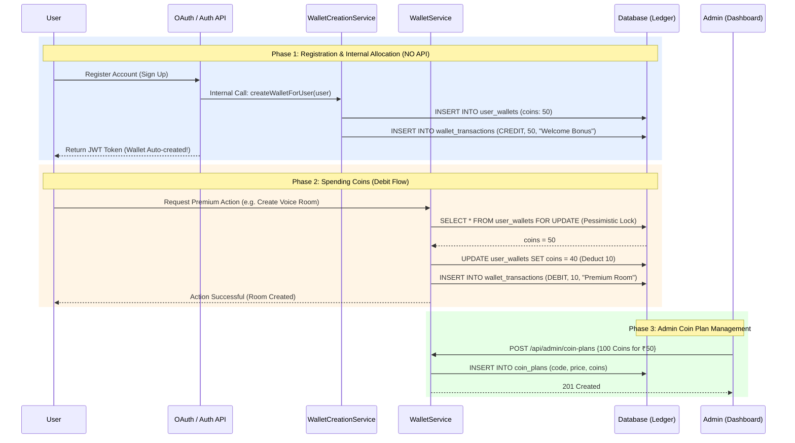

# Wallet & Coin System (FriendsTogether)

This document provides a highly detailed, comprehensive overview of the **Virtual Wallet**, **Coin Plan Management (Admin)**, **Ledger Tracking**, and **Transaction Logic** in the FriendsTogether backend.

---

## 1. Core Concepts & Database Schema

The economy of the platform runs on "Virtual Coins". There are three main SQL tables involved:

### 1.1 `user_wallets`
- **Fields:** `id`, `user_id` (FK), `coins`, `status` (ACTIVE/SUSPENDED), `lifetime_recharged_coins`, `last_transaction_at`
- **Purpose:** Tracks the current available balance for a user. 

### 1.2 `wallet_transactions` (The Ledger)
- **Fields:** `id`, `wallet_id` (FK), `amount`, `type` (CREDIT, DEBIT), `description`, `reference_id`, `created_at`
- **Purpose:** The immutable ledger. Every time a coin is added or removed, a row is inserted here. The `user_wallets.coins` is just a computed reflection of these ledger entries.

### 1.3 `coin_plans` (Admin Packages)
- **Fields:** `id`, `code`, `name`, `coins`, `bonus_coins`, `price_inr`, `status`, `badge`
- **Purpose:** Stores the packages that users can buy (e.g., "100 Coins for ₹50").

---

## 2. Wallet Allocation & Management Logic

### 2.1 Initial Wallet Allocation (Triggered via Auth APIs)
**No. There is strictly NO standalone REST API Endpoint** (like `POST /api/wallet/create`) to allocate or create a wallet. Exposing wallet creation to the frontend is a massive security risk.

Instead, the wallet allocation is triggered **Under the Hood** when the user hits the Authentication APIs:
- **`POST /api/v1/auth/signup`** (Standard Email Registration)
- **`POST /api/v1/auth/google`** (Google OAuth Login)

**How it works internally via `WalletCreationService.java`:**
1. **Event-Driven on Registration:** When the user hits any of the Auth APIs above, the `UserCreationService` successfully saves the user and then automatically invokes `walletCreationService.createWalletForUser(user)`.
2. **Welcome Bonus:** The backend immediately creates a wallet row with `currentBalance = 50`.
3. **Audit Trail:** It calls `createWelcomeBonusTransaction()` to insert a `CREDIT` row of 50 Coins into the `wallet_transactions` ledger with the reason `WELCOME_BONUS`.
4. **Safety Net (`ensureWalletExists`):** If an old user (from before the wallet feature existed) hits the `POST /api/v1/auth/login` API, the backend catches this and triggers `ensureWalletExists()` to automatically backfill their wallet and grant the 50 coins before returning the JWT token.

### 2.2 Strict Security rule: No REST Credit/Debit APIs
The endpoints to `credit()` and `debit()` a wallet are **intentionally NOT exposed as REST controllers**. 
- If a frontend could call `POST /api/wallet/credit { amount: 1000 }`, anyone could hack the app and get unlimited coins.
- Instead, `WalletService.credit()` and `WalletService.debit()` are strict Java methods marked with `@Transactional`. Only internal trusted services (like `PaymentWebhookService` or `GiftService`) can invoke them.

---

## 3. Transaction Logic: How Debit/Credit works

Every transaction runs inside a strict **Database Transaction** (`@Transactional`) to prevent Race Conditions (e.g., spending the same 10 coins twice at the exact same millisecond).

### 3.1 Debit Flow (Coin Deduction)
**Scenario:** User buys a Premium Voice Room (Costs 10 Coins).
1. `VoiceRoomService` calls `walletService.debit(userId, 10, "Premium Room Creation", "room_123")`.
2. Backend locks the wallet row in the DB using a pessimistic lock (`SELECT ... FOR UPDATE`).
3. Checks if `current_coins >= 10`. If not, throws `InsufficientBalanceException`.
4. Deducts 10 from `user_wallets`.
5. Inserts a new row into `wallet_transactions`: `DEBIT, 10, "Premium Room Creation"`.
6. Commits the SQL transaction.

### 3.2 Credit Flow
**Scenario:** User buys 100 coins via Razorpay.
1. `PaymentWebhookService` confirms the money arrived.
2. Calls `walletService.credit(userId, 100, "Purchase", "order_999")`.
3. Adds 100 to `user_wallets.coins` and also increments `lifetime_recharged_coins`.
4. Inserts row into `wallet_transactions`: `CREDIT, 100, "Purchase"`.

---

## 4. API Reference (Exact JSON Schemas)

All APIs are secured via Spring Security (`Authorization: Bearer <AccessToken>`).

### 4.1 User APIs (`WalletController`)

**1. Fetch Current Balance (`GET /api/wallet/balance`)**
- **Expected Response (200 OK):**
  ```json
  {
    "success": true,
    "message": "Wallet balance fetched successfully",
    "data": {
      "coins": 2500,
      "status": "ACTIVE",
      "lifetimeRechargedCoins": 12500,
      "lastTransactionAt": "2026-07-09T14:00:00"
    }
  }
  ```

**2. Fetch Ledger/Transaction History (`GET /api/wallet/transactions?page=0&size=20&type=DEBIT`)**
- **Expected Response (200 OK):**
  ```json
  {
    "success": true,
    "data": {
      "content": [
        {
          "id": 992,
          "amount": 10,
          "type": "DEBIT",
          "description": "Premium Room Creation",
          "createdAt": "2026-07-09T14:00:00"
        }
      ],
      "totalPages": 8,
      "totalElements": 150
    }
  }
  ```

**3. Dashboard Summary (`GET /api/wallet/summary`)**
- **Purpose:** Returns both the balance and the 5 most recent transactions in a single API call to save frontend network requests.

### 4.2 Admin APIs (`AdminCoinPlanController`)
*Requires `ROLE_ADMIN`.*

**1. Create a new Coin Plan (`POST /api/admin/coin-plans`)**
- **Input (JSON):**
  ```json
  {
    "code": "PLAN_100",
    "name": "Starter Pack",
    "coins": 100,
    "bonusCoins": 10,
    "priceInr": 50,
    "badge": "POPULAR",
    "displayOrder": 1
  }
  ```
- **Response (201 Created):** Returns the saved CoinPlan object.

**2. Update Plan Status (`PATCH /api/admin/coin-plans/{id}/status`)**
- **Input:** `{ "status": "INACTIVE" }`
- **Purpose:** Temporarily hide a plan from the frontend store without deleting its historical data.

**3. Delete Plan (`DELETE /api/admin/coin-plans/{id}`)**
- **Purpose:** Performs a "Soft Delete". It sets the status to `INACTIVE` so it stops showing up in the app, but old purchase receipts linking to this plan don't break.

---

## 5. Architecture Visualization

This diagram maps out how Wallet Initialization, Manual Deductions, and the Ledger Tracking operate within the backend ecosystem.


